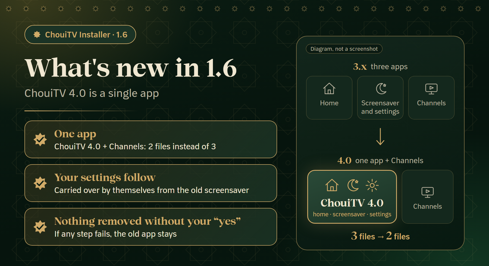
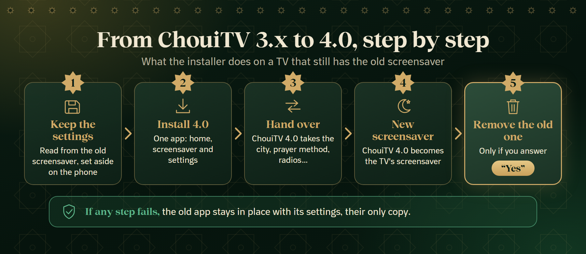

<p align="center"></p>

<p align="center"><a href="https://github.com/EMCHOUIT/ChouiTV-Installer/releases/latest/download/ChouiTV-Installer.apk"></a></p>

<p align="center"><a href="README.md">🇲🇦 العربية</a> &nbsp;·&nbsp; <a href="README.fr.md">🇫🇷 Français</a> &nbsp;·&nbsp; <b>🇬🇧 English</b></p>

<p align="center">
<a href="https://github.com/EMCHOUIT/ChouiTV-Installer/releases/latest"></a>

<a href="LICENSE"></a>
<a href="https://github.com/EMCHOUIT/ChouiTV-Installer/stargazers"></a>
</p>

<p align="center"><a href="#new">🆕 What's new</a> · <a href="#why">✨ Why</a> · <a href="#journey">🚀 The journey</a> · <a href="#installs">📦 Installed</a> · <a href="#safety">🛡️ Safety</a> · <a href="#cleanup">🧹 Cleanup</a> · <a href="#settings">🔁 Settings</a> · <a href="#migration">🔄 To 4.0</a> · <a href="#faq">❓ FAQ</a> · <a href="#build">🛠️ Build</a> · <a href="#versions">📜 Versions</a> · <a href="#download">⬇️ Download</a></p>

A small app on your phone that finds your TV, cleans it if you want, downloads the **latest version** of [ChouiTV](https://github.com/EMCHOUIT/ChouiTV), installs and sets it up, then copies your settings to another TV. **It guides you step by step, or you choose yourself. No computer, no commands.**

<p align="center"><a href="https://github.com/EMCHOUIT/ChouiTV-Installer/releases/latest/download/ChouiTV-Installer.apk"></a><br><sub>For Android 8+ phones · about 1 MB</sub></p>

<a id="new"></a>

## 🆕 What's new in 1.6



- **ChouiTV 4.0 is a single app**: home, screensaver and settings together. The installer now puts **one app + Channels** on the TV (2 files instead of 3).
- **If your TV still has the old screensaver**, its settings are kept, then carried into 4.0, and the old app is removed only after your "yes" ([details](#migration)).
- **Stricter trust** (1.4 and 1.5): every file is checked, and the version file must be signed by the owner ([Safety](#safety)).
- **Radios** travel with the other settings: countries, unticked stations and favourites.

<a id="why"></a>

## ✨ Why this app?

<table>
<tr><td width="50%" valign="top">🧭<br><b>Guided or free</b><br><sub>A step-by-step assistant, or five spaces to open directly.</sub></td><td width="50%" valign="top">🧹<br><b>A cleanup you control</b><br><sub>One box per app, with readable names, and nothing without your say.</sub></td></tr>
<tr><td width="50%" valign="top">🔁<br><b>Your settings travel</b><br><sub>Save one TV's settings under a name, send them to another, now or later.</sub></td><td width="50%" valign="top">🛡️<br><b>Everything can be undone</b><br><sub>Apps are turned off, not deleted, with a safety net on the TV.</sub></td></tr>
</table>

<a id="journey"></a>

## 🚀 The journey in five screens


1. **Language**: Arabic, French or English.
2. **The mode**: "Guide me" (a step-by-step assistant, with resume if you leave) or "I choose myself".
3. **The path or the spaces**: "Set up my TV", "Copy from one TV to another", "Send saved settings", "Put an app back", or the five spaces directly.
4. **The cleanup**: you see the plan before any change and tick what you do not use.
5. **Install and settings**: a bar with a percentage, then city, time zone and prayer method.

The install itself is two steps: **ChouiTV**, then **Channels**. If the TV still has the old screensaver, the [settings carry-over](#migration) comes with them.

<a id="installs"></a>

## 📦 What it installs

| App | Its role | Size |
|---|---|---|
| **ChouiTV 4.0** (`ma.chouitv.home`) | one app: the home screen with prayer, listening and dhikr, the screensaver (dhikr, guided tasbih, wisdom from history) and the settings | about 3.5 MB |
| **Channels app** | 311 live Arabic channels | |

ChouiTV 3.x was two apps (home and screensaver), so the installer put three files on the TV. Since 4.0 they are one app: the install is **two files**.

The app reads the version from [`latest.json`](https://raw.githubusercontent.com/EMCHOUIT/ChouiTV/main/latest.json): it always installs the **latest version** without being rebuilt, after the checks described below. An older version file that still lists two ChouiTV apps (home and screensaver) is still accepted: the screensaver line is ignored.

<a id="safety"></a>

## 🛡️ Safety

### What the installer checks before it touches your TV (1.4 and 1.5)

1. **The version file is signed** (1.5): the installer believes a `latest.json` only if its signature `latest.json.sig` matches the owner's public key built into the app. Someone who breaks into the GitHub account therefore cannot send the installer elsewhere: the signature is made on the owner's own computer, not on GitHub. A version file older than the minimum (ChouiTV version 180) is refused, so a TV is never taken back to a version with a known flaw.
2. **ChouiTV addresses only**: files come only from ChouiTV's releases page on GitHub, over https; an address containing anything that could redirect it is refused.
3. **A SHA-256 checksum is mandatory** for every file: no file without one, no file that does not match it.
4. **The ChouiTV app is checked on the phone before it is sent**: is it the right app, in the announced version, signed with ChouiTV's key? If not, the file is deleted and nothing is sent.
5. **The version is checked again on the TV after the install**, and each app is retried **once** if it fails.
6. **No removal without asking**: if an app of the same name is already on the TV but signed with another key, the installer asks before removing it; its settings are kept aside and put back afterwards as far as possible.

**What is not checked, plainly:**

- **The Channels app** is a third-party build kept as it is: only its checksum is checked (the SHA-256 from the version file, or one pinned in the installer), not its signing key or its version number.
- **What is inside the ChouiTV apps** is not audited by the installer: it makes sure they come from the owner and are as published, not that they are flawless.
- **A stolen key is not covered**: whoever holds the owner's signing key, or their computer, can sign a version file.
- **The installer's own file** is for you to check: see [Check the file](#download).

### On the TV itself

- **Safety net**: before turning the TV's original home off, the app arms a script on the TV that puts it back by itself after 5 minutes if ChouiTV does not open.
- **Respect for your TV**: if it refuses to turn its home off (like the Nokia Streaming Box 8000), it keeps it and you are told.
- **Cleanup without risk**: it is optional, turns apps off without deleting them, checks the TV after each group and puts them back if it gets unwell; the "Turn apps back on" space puts an app back whenever you want.
- **Privacy**: no accounts, no ads, no tracking; the key that identifies your phone stays in it.

> [!TIP]
> **When you are done**: turn "Network debugging" off on the TV.


<a id="cleanup"></a>

## 🧹 Clean your TV, safely


Some TVs (Xiaomi, TCL and others) ship with preinstalled apps you do not need: tracking, analytics, ads, services that slow the device down. You may also have apps that start with the TV without you using them. **The cleanup is optional, and you decide.**

- **One box per app**: "Preinstalled apps" (ticked for you), "Streaming and entertainment" (Netflix, Prime Video… unticked) and "Your installed apps", with an advice for the ones that start with the TV and slow it down.
- **Readable names**: the app name, its package below.
- **A confirmation before it starts**: you look over the list and leave unticked the ones you use, they stay untouched.
- **Turned off, never deleted**: the TV is checked after each group, put back if it gets unwell, and if the connection is lost it puts everything back by itself within 5 minutes.
- **Always protected**: ChouiTV, Google services, the settings and any home screen.
- **Put an app back any time**: the "Turn apps back on" space reads what is off on the TV itself.

<a id="settings"></a>

## 🔁 Copy your settings to another TV


Use the **Get the settings** and **Send settings** spaces (or the guided "Copy from one TV to another" path).

- **Save under a name**: the settings of the connected TV (city, prayer, adhan, panels, teams, home shortcuts, radios: countries, unticked stations and favourites…) are kept on your phone, nowhere else.
- **Send now or later**: if both TVs are together, send right away; otherwise take the settings with you and send them from "Send saved settings".
- **Preview and undo**: you see the changes before applying them, and the send keeps a copy of the previous settings.
- **Never saved**: the IP address or Wi-Fi name, the serial number, your photos and your tasks.

ChouiTV 3.173 or newer is needed on both TVs.

<a id="migration"></a>

## 🔄 Moving from ChouiTV 3.x to 4.0



If your TV has the old screensaver app (`ma.chouitv.screensaver`), you do not have to do anything yourself. The installer goes in this order:

1. **It keeps the settings**: it reads those of the old screensaver (city, prayer method, radios…) and sets them aside in the app's private space on your phone.
2. **It installs ChouiTV 4.0.**
3. **It hands the settings over** to 4.0.
4. **It chooses the new screensaver**: 4.0's screensaver becomes the TV's screensaver.
5. **It asks you** whether to remove the old app (keep it or remove it). Nothing is removed without your "yes".

**What stays safe**: if the settings could not be kept, if 4.0 refuses them, or if you do not answer "yes", the old app stays in place with its settings, since it then holds the only copy. The temporary copy is erased from the phone at the end. If the TV does not have the old app, nothing is carried over.

The result shows on the end screen: "Settings carried over, old app removed", "… old app kept" or "Could not carry them over: the old app stays".

<a id="faq"></a>

## ❓ FAQ

<details><summary><b>I can't find my TV in the list</b></summary>

Check that the phone and the TV are on the **same Wi-Fi** and that "Network debugging" is on. You can also type the TV's address by hand.
</details>

<details><summary><b>The "Allow" window does not show on the TV</b></summary>

The app waits two minutes. If the window does not appear, restart the TV and try again: an earlier request may be stuck.
</details>

<details><summary><b>The Home button does not open ChouiTV</b></summary>

Some TVs force their own home. The app tells you at the end, and you find ChouiTV in the TV's apps. In any case, the TV puts its original home back by itself if the new one does not work.
</details>

<details><summary><b>How do I go back?</b></summary>

Turn the TV's home back on in its settings, or use `optimize/reset.sh` from [ChouiTV](https://github.com/EMCHOUIT/ChouiTV).
</details>

<details><summary><b>Is the cleanup safe?</b></summary>

It is optional, turns apps off without deleting them, shows you the plan first and checks the TV after each group. But an app that is off no longer updates, and a system update can turn some back on. Some TVs would lose their saved Wi-Fi if the setup wizard were turned off, so it is protected too.
</details>

<details><summary><b>How do I undo a cleanup?</b></summary>

Open the "Turn apps back on" space and tick the ones you want back: it reads what is off on the TV itself, so any phone can do it. A plain-text copy is also on the TV: `/data/local/tmp/chouitv-restore.txt`.
</details>

<details><summary><b>What is the difference between "Guide me" and "I choose myself"?</b></summary>

The first is an assistant that tells you what to do step by step and lets you resume if you leave. The second opens the five spaces directly. You can change the mode at any time.
</details>

<details><summary><b>How do I copy my settings to another TV?</b></summary>

With "Copy from one TV to another": you save the first TV's settings under a name, then send them right away if both TVs are together, or later from "Send saved settings". ChouiTV 3.173 or newer is needed on both TVs; the preview shows before applying and the send can be undone.
</details>

<details><summary><b>I see two entries with the same name in Android's screensaver list</b></summary>

This happens if you move to 4.0 by hand (installing it over the old one, without the installer) while the old screensaver is still on the TV: both apps offer a screensaver named ChouiTV. Pick the new one (4.0), then remove the old one in the TV's settings, under Apps. With the installer, it picks the new one itself and asks whether to remove the old one.
</details>

<details><summary><b>The TV stops answering during the move to 4.0</b></summary>

If the connection is lost before anything was kept, the TV has not changed. If it is lost after 4.0 was installed, the old app is not removed (that only happens after your "yes"): restart the TV, reopen the installer and run it again; as long as the old app is there, it tries the carry-over again. Check that the phone and the TV are on the same Wi-Fi and that "Network debugging" is on.
</details>

<details><summary><b>The settings carry-over failed: what happens to the old app?</b></summary>

It stays in place with its settings, and you are not even offered to remove it: it holds the only copy. The end screen says "Could not carry them over: the old app stays". You can try again from "Set up my TV", set 4.0 up by hand, or send saved settings from "Send saved settings".
</details>

<details><summary><b>Three files or two? Where is the screensaver app?</b></summary>

Since 4.0, the home screen, the screensaver and the settings are one app (`ma.chouitv.home`), and the installer only puts that one and the Channels app on the TV. The screensaver is inside the app: pick it in the TV's settings, under Screensaver, if the installer has not done it.
</details>

<a id="build"></a>

## 🛠️ Build

JDK 17 and the Android SDK (platform 34):

```bash
git clone https://github.com/EMCHOUIT/ChouiTV-Installer
cd ChouiTV-Installer
./gradlew :app:assembleRelease      # the file is in app/build/outputs/apk/release
./gradlew :app:testDebugUnitTest    # 108 tests on the JVM
```

Current version: **1.6** (`versionCode 9`), for Android 8 or newer (`minSdk 26`).

The drawn images in `docs/media` (the "What's new" card, the 3.x to 4.0 diagram, the version number on the banner, the QR code) are rebuilt with `python docs/media/build_media.py` (needs Pillow and Edge or Chrome); the phone screenshots are real and are not generated.

<a id="versions"></a>

## 📜 Versions

| Version | What changed |
|---|---|
| **1.6** | ChouiTV 4.0 is a single app: the installer puts one app + Channels; carry-over of the old screensaver's settings, removal only after a "yes"; radios are part of the saved settings |
| **1.5** | the version file must be signed by the owner (`latest.json.sig`) |
| **1.4** | trust: mandatory checksum, ChouiTV addresses only, each app checked on the phone (app, version, key) then on the TV, one retry, a question before removing an app signed with another key |
| **1.3** | refresh button, brand and model on the TV list, one end screen for every operation |
| **1.2** | two modes (guided or free), five spaces, cleanup with one box per app, settings copied between TVs |

<a id="download"></a>

<h2 align="center">⬇️ Direct download</h2>

<p align="center"><br><sub>Scan it from your computer to open the link on your phone.</sub></p>

<p align="center"><a href="https://github.com/EMCHOUIT/ChouiTV-Installer/releases/latest/download/ChouiTV-Installer.apk"></a><br><sub><code>ChouiTV-Installer.apk</code> · about 1 MB</sub></p>

<p align="center"><a href="https://github.com/EMCHOUIT/ChouiTV-Installer/releases/latest"></a> <a href="https://github.com/EMCHOUIT/ChouiTV-Installer/releases"></a></p>

<p align="center">📱 Android 8 or newer &nbsp;·&nbsp; 🔒 Signed, no account, no ads &nbsp;·&nbsp; 📦 <a href="https://github.com/EMCHOUIT/ChouiTV-Installer/releases">All versions</a></p>

<h3 align="center">Install in three steps</h3>

<table align="center">
<tr><td width="33%" valign="top" align="center">1️⃣<br><br><b>Download</b> the <code>ChouiTV-Installer.apk</code> file on your phone (the button above, or the QR code from another screen).</td><td width="33%" valign="top" align="center">2️⃣<br><br><b>Open it.</b> If Android asks for permission, allow your browser or file manager to install apps once. An "unknown app" warning may appear: the code is open and you can build it yourself (<a href="#build">Build</a>).</td><td width="33%" valign="top" align="center">3️⃣<br><br><b>Open ChouiTV Installer</b> and follow the steps.</td></tr>
</table>

<div align="center">

<details><summary><b>🔍 Check the file</b></summary>

The direct link always downloads the **latest version**. On the [release page](https://github.com/EMCHOUIT/ChouiTV-Installer/releases/latest) the same file also exists under a name that carries the number (for example `ChouiTV-Installer-1.6.apk`). The page shows the SHA-256 next to the file. Compare it with the result of:

```bash
sha256sum ChouiTV-Installer.apk                       # Linux, macOS
certutil -hashfile ChouiTV-Installer.apk SHA256       # Windows
```

The signing certificate fingerprint (SHA-256) is the same for every version:

```text
f29f993b7456170455dcc574a2bc5f1f74b97f7995a564f8a839175d068a79c1
```

To check it:

```bash
apksigner verify --print-certs ChouiTV-Installer.apk
```
</details>

</div>

## 💚 Credits and licence

**MIT** licence (EMChouit). Fonts and their licences: [THIRD_PARTY_NOTICES.md](THIRD_PARTY_NOTICES.md). The apps it installs are those of [ChouiTV](https://github.com/EMCHOUIT/ChouiTV). **Like the project? Give it a star ⭐, it keeps us going.**
