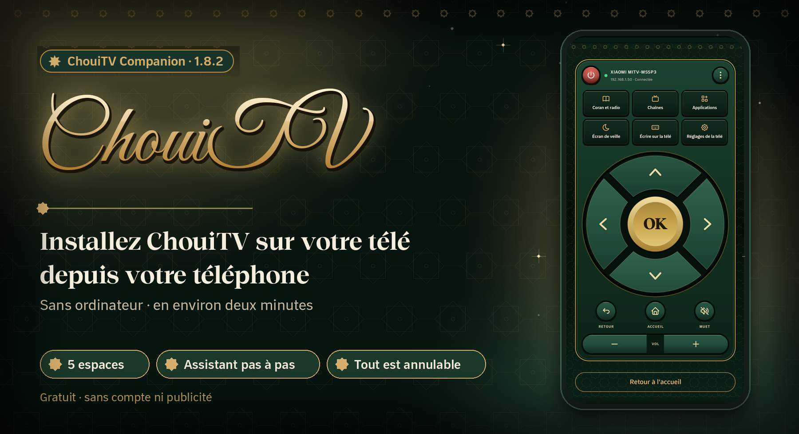
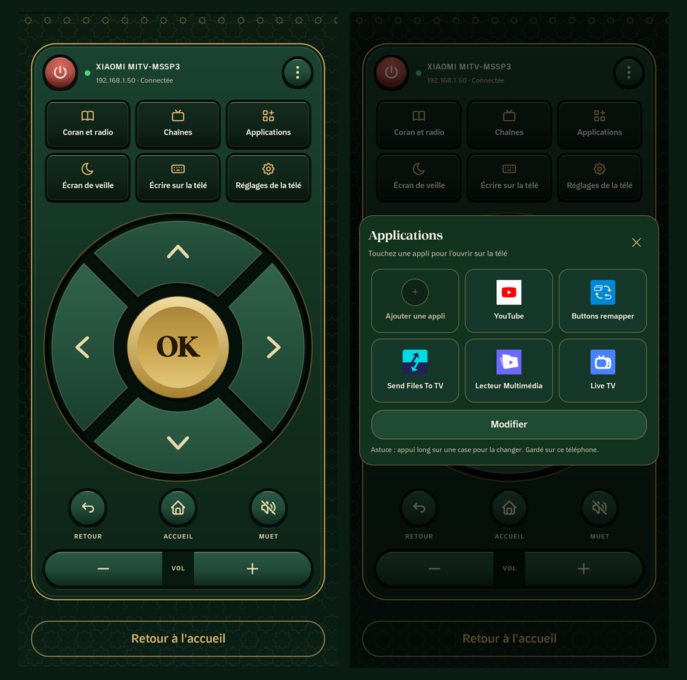
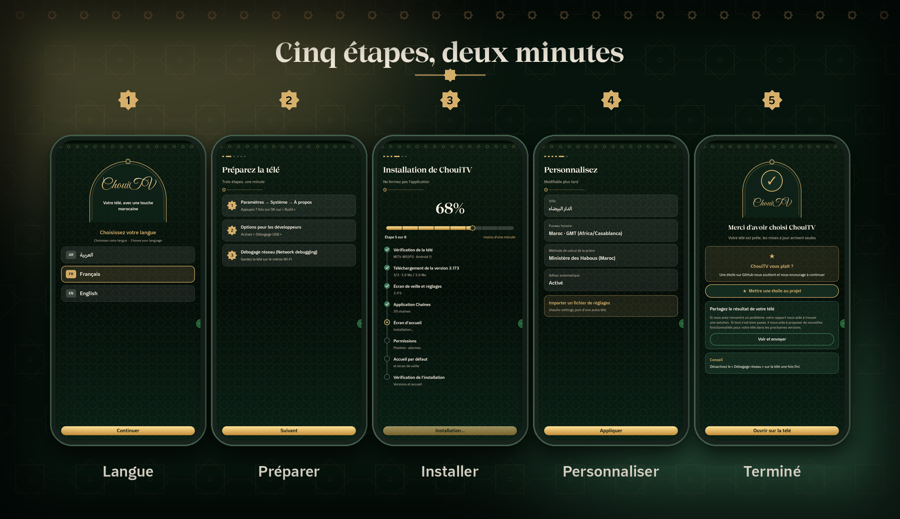
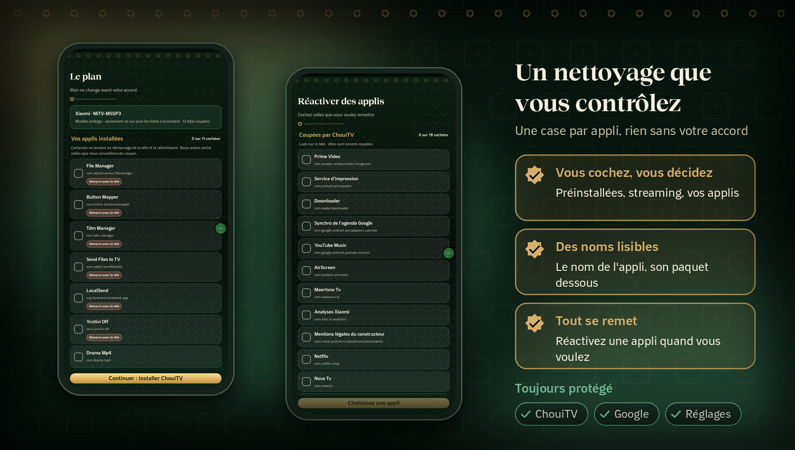
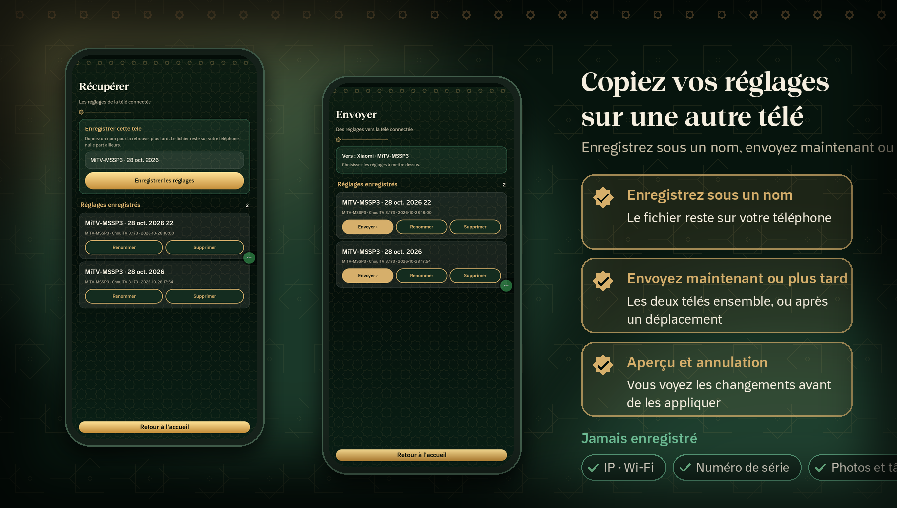
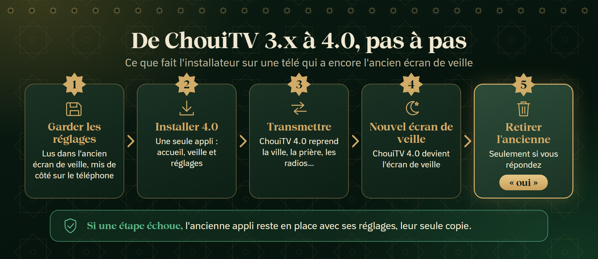

<p align="center"></p>

<p align="center"><a href="https://github.com/EMCHOUIT/ChouiTV-Installer/releases/latest/download/ChouiTV-Installer.apk"></a></p>

<p align="center"><a href="README.md">🇲🇦 العربية</a> &nbsp;·&nbsp; <b>🇫🇷 Français</b> &nbsp;·&nbsp; <a href="README.en.md">🇬🇧 English</a></p>

<p align="center">
<a href="https://github.com/EMCHOUIT/ChouiTV-Installer/releases/latest"></a>

<a href="LICENSE"></a>
<a href="https://github.com/EMCHOUIT/ChouiTV-Installer/stargazers"></a>
</p>

<p align="center"><a href="#new">🆕 Nouveau</a> · <a href="#why">✨ Pourquoi</a> · <a href="#journey">🚀 Le parcours</a> · <a href="#installs">📦 Installé</a> · <a href="#safety">🛡️ Sécurité</a> · <a href="#cleanup">🧹 Nettoyage</a> · <a href="#settings">🔁 Réglages</a> · <a href="#migration">🔄 Vers la 4.0</a> · <a href="#faq">❓ FAQ</a> · <a href="#build">🛠️ Compiler</a> · <a href="#versions">📜 Versions</a> · <a href="#download">⬇️ Téléchargement</a></p>

Une petite appli sur votre téléphone (**ChouiTV Companion**) qui trouve votre télé, la pilote comme une télécommande, la nettoie si vous le voulez, télécharge la **dernière version** de [ChouiTV](https://github.com/EMCHOUIT/ChouiTV), l'installe et la règle, puis copie vos réglages sur une autre télé. **Elle vous guide pas à pas, ou vous choisissez vous-même. Sans ordinateur, sans commande.**

<p align="center"><a href="https://github.com/EMCHOUIT/ChouiTV-Installer/releases/latest/download/ChouiTV-Installer.apk"></a><br><sub>Pour téléphone Android 8 ou plus · environ 1 Mo</sub></p>

> 🛡️ **Si Google affiche un message de sécurité** (Play Protect) quand vous ouvrez le fichier, c'est normal : l'appli est récente et Google ne la connaît pas encore. Choisissez **« Installer sans analyser »**. Elle ne demande aucune permission sensible et n'installe rien sur votre téléphone : elle envoie seulement ChouiTV à votre télé.

<a id="new"></a>

## 🆕 Nouveau dans la 1.8 : ChouiTV Companion



L'appli s'appelle désormais **ChouiTV Companion** (elle s'appelait ChouiTV Installer jusqu'à la 1.7) : elle installe et nettoie toujours, et **elle pilote aussi la télé**.

- **Une vraie télécommande dans votre poche** : un pavé à quatre secteurs autour d'un grand OK, Retour, Accueil, Muet, volume et veille, avec des touches en relief qui s'enfoncent sous le doigt. Gardez le doigt sur une flèche ou sur le volume pour répéter.
- **Six raccourcis** : Coran et radio, Chaînes, Applications, Écran de veille, Écrire sur la TV, Réglages de la TV.
- **Écrire sur la TV, même en arabe** : tapez sur le clavier du téléphone, puis « Envoyer » ou « Effacer ».
- **Vos applis sur six boutons** : choisissez parmi les applis de la télé, avec leur vrai nom et leur icône, et lancez-les d'un appui. Les boutons sont gardés sur votre téléphone.
- **La télé est retenue** : à l'ouverture, une carte « Dernière télé » ouvre la télécommande d'un seul appui (ou directement, si vous le choisissez), et l'appli se reconnecte toute seule si le Wi-Fi ou la télé décroche.
- **Éteindre** demande confirmation : une télé éteinte ainsi ne se rallume qu'avec sa télécommande d'origine.
- **Accessible** : l'anneau est lu par TalkBack comme cinq boutons, et l'écran passe en arabe de droite à gauche.
- **Un volume rapide et précis** (1.8.1) : un curseur règle le niveau de 0 à 100 en une seule commande, le niveau est lu sur la télé, et une limite « Volume maximum » protège les oreilles de la famille.
- **Le volume suit chaque télé** (1.8.2) : échelle lue sur la télé ou saisie à la main, pas réglable pour les touches + et −, barre de volume de la télé affichée à chaque réglage.
- **Une appli plus simple** (1.9) : trois onglets en bas (Télécommande, Ma télé, Plus), des tâches qui vont directement à la dernière télé, et « À propos et mise à jour » dans Plus.
- **La télécommande d'abord** (2.0) : l'appli s'ouvre sur la télécommande, « Mes télés » gère plusieurs télés nommées, chaque télé a sa page, et « Options » regroupe langue, volume et aide.
- **Plus jamais bloqué** (2.2) : la télécommande s'ouvre toujours (démo sans télé), un bandeau dit pourquoi la télé ne répond pas, l'appli réessaie toute seule, et la recherche montre chaque télé dès qu'elle répond.
- **Équiper une télé, pas à pas** (2.1) : une carte « Équiper cette télé », un « Dépannage » qui part du symptôme, un journal par télé, et une dernière relecture avant de couper des applis.

La télécommande a besoin que le « Débogage réseau » soit activé sur la télé, comme le reste de l'appli.

<a id="why"></a>

## ✨ Pourquoi cette appli ?

<table>
<tr><td width="50%" valign="top">🧭<br><b>Guidé ou libre</b><br><sub>Un assistant pas à pas, ou cinq espaces à ouvrir directement.</sub></td><td width="50%" valign="top">🧹<br><b>Un nettoyage que vous contrôlez</b><br><sub>Une case par appli, avec des noms lisibles, et rien sans votre accord.</sub></td></tr>
<tr><td width="50%" valign="top">🔁<br><b>Vos réglages voyagent</b><br><sub>Enregistrez les réglages d'une télé sous un nom, envoyez-les à une autre, maintenant ou plus tard.</sub></td><td width="50%" valign="top">🛡️<br><b>Tout est annulable</b><br><sub>Les applis sont coupées, pas supprimées, avec un filet de sécurité sur la télé.</sub></td></tr>
</table>

<a id="journey"></a>

## 🚀 Le parcours en cinq écrans



1. **Langue** : arabe, français ou anglais.
2. **Le mode** : « Je me laisse guider » (un assistant pas à pas, avec reprise si vous quittez) ou « Je choisis moi-même ».
3. **Le parcours ou les espaces** : « Équiper ma télé », « Copier d'une télé à l'autre », « Envoyer des réglages enregistrés », « Remettre une appli », ou les cinq espaces directement.
4. **Le nettoyage** : vous voyez le plan avant tout changement et vous cochez ce que vous n'utilisez pas.
5. **Installation et réglages** : une barre avec pourcentage, puis ville, fuseau horaire et méthode de prière.

L'installation elle-même tient en deux étapes : **ChouiTV**, puis **Chaînes**. Si la télé a encore l'ancien écran de veille, s'y ajoute la [reprise des réglages](#migration).

<a id="installs"></a>

## 📦 Ce qui est installé

| Application | Son rôle | Taille |
|---|---|---|
| **ChouiTV 4.0** (`ma.chouitv.home`) | une seule appli : l'écran d'accueil avec prière, écoute et dhikr, l'écran de veille (dhikr, tasbih guidé, sagesse de l'histoire) et les réglages | environ 3,5 Mo |
| **Application Chaînes** | 311 chaînes arabes en direct | |

ChouiTV 3.x se composait de deux applis (l'accueil et l'écran de veille), et l'installateur posait donc trois fichiers. Depuis la 4.0, elles n'en font plus qu'une : l'installation compte **deux fichiers**.

L'appli lit la version dans [`latest.json`](https://raw.githubusercontent.com/EMCHOUIT/ChouiTV/main/latest.json) : elle installe donc toujours la **dernière version** sans être recompilée, après les contrôles décrits plus bas. Un ancien fichier de version qui liste encore deux applis ChouiTV (accueil et écran de veille) reste accepté : la ligne de l'écran de veille est ignorée.

<a id="safety"></a>

## 🛡️ Sécurité

### Ce que l'installateur vérifie avant de toucher à votre télé (1.4 et 1.5)

1. **Le fichier de version est signé** (1.5) : l'installateur ne croit un `latest.json` que si sa signature `latest.json.sig` correspond à la clé publique du propriétaire, intégrée à l'appli. Qui pirate le compte GitHub ne peut donc pas l'envoyer ailleurs : la signature est faite sur l'ordinateur du propriétaire, pas sur GitHub. Un fichier de version plus ancien que le minimum (version 180 de ChouiTV) est refusé, pour qu'on ne ramène pas une télé vers une version au défaut connu.
2. **Adresses ChouiTV seulement** : les fichiers ne viennent que de la page des versions de ChouiTV sur GitHub, en https ; une adresse qui contient de quoi la détourner est refusée.
3. **Empreinte SHA-256 obligatoire** pour chaque fichier : pas de fichier sans empreinte, pas de fichier qui ne la respecte pas.
4. **L'appli ChouiTV est contrôlée sur le téléphone avant l'envoi** : est-ce la bonne appli, dans la version annoncée, signée avec la clé de ChouiTV ? Sinon le fichier est supprimé et rien n'est envoyé.
5. **La version est revérifiée sur la télé après l'installation**, et chaque appli est retentée **une seule fois** en cas d'échec.
6. **Pas de retrait sans question** : si une appli du même nom est déjà sur la télé mais signée avec une autre clé, l'installateur vous demande avant de la retirer ; ses réglages sont gardés de côté et remis ensuite, autant que possible.

**Ce qui n'est pas vérifié, dit franchement :**

- **L'appli Chaînes** est un build tiers gardé tel quel : seule son empreinte est contrôlée (SHA-256 du fichier de version, ou empreinte fixée dans l'installateur), ni sa clé de signature ni son numéro de version.
- **Le contenu des applis ChouiTV** n'est pas audité par l'installateur : il s'assure qu'elles viennent du propriétaire et sont telles que publiées, pas qu'elles sont sans défaut.
- **Une clé volée n'est pas couverte** : qui détient la clé de signature du propriétaire, ou son ordinateur, peut signer un fichier de version.
- **Le fichier de l'installateur lui-même** se vérifie de votre côté : voir [Vérifier le fichier](#download).

### Sur la télé elle-même

- **Filet de sécurité** : avant de couper l'accueil d'origine, l'appli arme sur la télé un script qui le rétablit tout seul au bout de 5 minutes si ChouiTV ne s'ouvre pas.
- **Respect de votre télé** : si elle refuse de couper son accueil (comme la Nokia Streaming Box 8000), il est conservé et vous en êtes informé.
- **Nettoyage sans risque** : il est facultatif, il coupe sans supprimer, vérifie la télé après chaque groupe et remet tout en place si elle va mal ; l'espace « Réactiver des applis » remet une appli à la demande.
- **Vie privée** : pas de compte, pas de publicité, pas de suivi ; la clé qui identifie votre téléphone y reste.

> [!TIP]
> **Une fois fini** : désactivez le « Débogage réseau » sur la télé.


<a id="cleanup"></a>

## 🧹 Nettoyez votre télé en sécurité



Certaines télés (Xiaomi, TCL, etc.) arrivent avec des applis préinstallées dont vous n'avez pas besoin : suivi, statistiques, publicités, services qui ralentissent l'appareil. Vous avez aussi peut-être des applis qui démarrent avec la télé sans que vous les utilisiez. **Le nettoyage est facultatif, et c'est vous qui décidez.**

- **Une case par appli** : « Applis préinstallées » (cochées d'avance), « Streaming et divertissement » (Netflix, Prime Video… décochées) et « Vos applis installées », avec un conseil pour celles qui démarrent avec la télé et la ralentissent.
- **Des noms lisibles** : le nom de l'appli, son paquet en dessous.
- **Une confirmation avant de commencer** : vous relisez la liste et laissez décochées celles que vous utilisez, elles restent intactes.
- **On coupe, on ne supprime pas** : la télé est vérifiée après chaque groupe, remise en place si elle va mal, et si la connexion est perdue elle remet tout d'elle-même au bout de 5 minutes.
- **Toujours protégé** : ChouiTV, les services Google, les réglages et tout écran d'accueil.
- **Remettez une appli quand vous voulez** : l'espace « Réactiver des applis » lit ce qui est coupé sur la télé elle-même.

<a id="settings"></a>

## 🔁 Copiez vos réglages sur une autre télé



Utilisez les espaces **Récupérer des réglages** et **Envoyer des réglages** (ou le parcours guidé « Copier d'une télé à l'autre »).

- **Enregistrez sous un nom** : les réglages de la télé connectée (ville, prière, adhan, panneaux, équipes, raccourcis de l'accueil, radios : pays, stations décochées et favorites…) sont gardés sur votre téléphone, nulle part ailleurs.
- **Envoyez maintenant ou plus tard** : si les deux télés sont ensemble, envoyez tout de suite ; sinon emportez les réglages et envoyez-les depuis « Envoyer des réglages enregistrés ».
- **Aperçu et annulation** : vous voyez les changements avant de les appliquer, et l'envoi garde une copie des réglages précédents.
- **Jamais enregistré** : l'adresse IP ou le nom du Wi-Fi, le numéro de série, vos photos et vos tâches.

ChouiTV 3.173 ou plus est nécessaire sur les deux télés.

<a id="migration"></a>

## 🔄 Passer de ChouiTV 3.x à la 4.0



Si votre télé a l'ancienne appli d'écran de veille (`ma.chouitv.screensaver`), vous n'avez rien à faire vous-même. L'installateur procède dans cet ordre :

1. **Il garde les réglages** : il lit ceux de l'ancien écran de veille (ville, méthode de prière, radios…) et les met de côté dans l'espace privé de l'appli, sur votre téléphone.
2. **Il installe ChouiTV 4.0.**
3. **Il transmet les réglages** à la 4.0.
4. **Il choisit le nouvel écran de veille** : celui de la 4.0 devient l'écran de veille de la télé.
5. **Il vous demande** si l'ancienne appli doit être retirée (la garder ou la retirer). Rien n'est retiré sans votre « oui ».

**Ce qui reste en sécurité** : si les réglages n'ont pas pu être gardés, si la 4.0 les refuse, ou si vous ne répondez pas « oui », l'ancienne appli reste en place avec ses réglages, car elle en détient alors la seule copie. La copie temporaire est effacée du téléphone à la fin. Si la télé n'a pas l'ancienne appli, rien n'est repris.

Le résultat s'affiche sur l'écran de fin : « Réglages repris, ancienne appli retirée », « … ancienne appli conservée » ou « Reprise impossible : l'ancienne appli reste en place ».

<a id="faq"></a>

## ❓ Questions fréquentes

<details><summary><b>Je ne trouve pas ma télé dans la liste</b></summary>

Vérifiez que le téléphone et la télé sont sur le **même Wi-Fi** et que le « Débogage réseau » est activé sur la télé. Vous pouvez aussi saisir l'adresse de la télé à la main.
</details>

<details><summary><b>La fenêtre « Autoriser » n'apparaît pas sur la télé</b></summary>

L'appli attend deux minutes. Si la fenêtre n'apparaît pas, redémarrez la télé puis réessayez : une demande précédente est peut-être restée bloquée.
</details>

<details><summary><b>Le bouton Home n'ouvre pas ChouiTV</b></summary>

Certaines télés imposent leur accueil. L'appli vous le dit à la fin, et vous trouvez ChouiTV dans les applications de la télé. Dans tous les cas, la télé rétablit seule son accueil d'origine si le nouveau ne fonctionne pas.
</details>

<details><summary><b>Comment revenir en arrière ?</b></summary>

Réactivez l'accueil de la télé dans ses réglages, ou utilisez `optimize/reset.sh` de [ChouiTV](https://github.com/EMCHOUIT/ChouiTV).
</details>

<details><summary><b>Le nettoyage est-il sûr ?</b></summary>

Il est facultatif, il coupe sans supprimer, vous montre le plan d'abord et vérifie la télé après chaque groupe. Mais une appli coupée ne se met plus à jour, et une mise à jour du système peut en réactiver. Certaines télés perdraient leur Wi-Fi enregistré si l'assistant de configuration était coupé : il est donc protégé lui aussi.
</details>

<details><summary><b>Comment annuler un nettoyage ?</b></summary>

Ouvrez l'espace « Réactiver des applis » et cochez celles que vous voulez remettre : il lit ce qui est coupé sur la télé elle-même, n'importe quel téléphone peut donc le faire. Une copie en texte est aussi sur la télé : `/data/local/tmp/chouitv-restore.txt`.
</details>

<details><summary><b>Quelle différence entre « Je me laisse guider » et « Je choisis moi-même » ?</b></summary>

Le premier est un assistant qui vous dit quoi faire étape par étape et permet de reprendre si vous quittez. Le second ouvre directement les cinq espaces. Vous pouvez changer de mode à tout moment.
</details>

<details><summary><b>Comment copier mes réglages sur une autre télé ?</b></summary>

Avec « Copier d'une télé à l'autre » : vous enregistrez les réglages de la première télé sous un nom, puis vous les envoyez tout de suite si les deux télés sont ensemble, ou plus tard depuis « Envoyer des réglages enregistrés ». ChouiTV 3.173 ou plus est nécessaire sur les deux télés ; l'aperçu s'affiche avant d'appliquer et l'envoi peut s'annuler.
</details>

<details><summary><b>Je vois deux entrées du même nom dans la liste des économiseurs d'écran d'Android</b></summary>

Cela arrive si vous passez à la 4.0 à la main (en l'installant par-dessus, sans l'installateur) alors que l'ancien écran de veille est encore sur la télé : les deux applis proposent un écran de veille nommé ChouiTV. Choisissez le nouveau (4.0), puis retirez l'ancien dans les réglages de la télé, rubrique Applications. Avec l'installateur, c'est lui qui choisit le nouveau et vous demande s'il faut retirer l'ancien.
</details>

<details><summary><b>La télé ne répond plus pendant le passage à la 4.0</b></summary>

Si la connexion est perdue avant que quoi que ce soit soit gardé, la télé n'a pas changé. Si elle est perdue après l'installation de la 4.0, l'ancienne appli n'est pas retirée (elle ne l'est qu'après votre « oui ») : redémarrez la télé, rouvrez l'installateur et relancez l'opération ; tant que l'ancienne appli est là, il retente la reprise. Vérifiez que le téléphone et la télé sont sur le même Wi-Fi et que le « Débogage réseau » est activé.
</details>

<details><summary><b>La reprise des réglages a échoué : que devient l'ancienne appli ?</b></summary>

Elle reste en place avec ses réglages, et il ne vous est même pas proposé de la retirer : elle détient la seule copie. L'écran de fin indique « Reprise impossible : l'ancienne appli reste en place ». Vous pouvez réessayer depuis « Équiper ma télé », régler la 4.0 à la main, ou envoyer des réglages enregistrés depuis « Envoyer des réglages enregistrés ».
</details>

<details><summary><b>Trois fichiers ou deux ? Où est l'appli d'écran de veille ?</b></summary>

Depuis la 4.0, l'écran d'accueil, l'écran de veille et les réglages forment une seule appli (`ma.chouitv.home`), et l'installateur ne pose que celle-ci et l'appli Chaînes. L'écran de veille est dans l'appli : choisissez-le dans les réglages de la télé, rubrique Écran de veille, si l'installateur ne l'a pas fait.
</details>

<details><summary><b>Comment la télécommande retient-elle ma télé ?</b></summary>

Après une première connexion, l'appli garde l'adresse et le nom de la télé. À l'ouverture, la carte « Dernière télé » ouvre la télécommande d'un appui, sans nouvelle recherche. Si la connexion tombe, l'appli réessaie cinq fois avec des attentes de plus en plus longues, puis affiche « Télé éteinte ou hors Wi-Fi » : un appui sur le nom de la télé relance. Si l'adresse de la télé a changé, passez par « Changer de télé ».
</details>

<details><summary><b>J'ai éteint la télé depuis l'appli et elle ne se rallume pas</b></summary>

C'est voulu et annoncé par la confirmation : une télé en veille coupe son réseau, l'appli ne peut donc pas la rallumer. Utilisez la télécommande d'origine, puis vérifiez que le « Débogage réseau » est toujours activé.
</details>

<details><summary><b>Comment mettre mes applis sur les six boutons ?</b></summary>

Ouvrez « Applications », touchez une case vide (ou « Modifier », ou un appui long sur une case) et choisissez une appli dans la liste de celles de la télé, avec son nom et son icône. Une appli ne tient que sur un seul bouton. Les boutons sont gardés sur votre téléphone, pour l'adresse de cette télé.
</details>

<a id="build"></a>

## 🛠️ Compiler

JDK 17 et Android SDK (plateforme 34) :

```bash
git clone https://github.com/EMCHOUIT/ChouiTV-Installer
cd ChouiTV-Installer
./gradlew :app:assembleRelease      # le fichier est dans app/build/outputs/apk/release
./gradlew :app:testDebugUnitTest    # 181 tests sur la JVM
```

Version actuelle : **2.2** (`versionCode 19`), pour Android 8 ou plus (`minSdk 26`).

Les images dessinées de `docs/media` (carte « Nouveau », schéma de passage à la 4.0, numéro de version de la bannière, QR code) se refont avec `python docs/media/build_media.py` (Pillow et Edge ou Chrome requis) ; les captures du téléphone, elles, sont réelles et ne sont pas générées.

<a id="versions"></a>

## 📜 Versions

| Version | Ce qui change |
|---|---|
| **2.2** | Jamais bloqué : l'appli s'ouvre toujours sur la télécommande, grisée en démonstration quand il n'y a aucune télé, avec « Connexion… » sous le nom d'une télé connue ; plus d'écran d'attente ni de fenêtre « ne répond pas » ; un bandeau dit la cause (pas de Wi-Fi, autre Wi-Fi, télé qui démarre, Débogage réseau coupé, télé éteinte, autorisation à donner sur la télé) et l'appli réessaie toute seule (toutes les 3 s, puis moins souvent) ; elle se reconnecte dès que le Wi-Fi revient ; la recherche de télés montre chaque télé dès qu'elle répond, avec son état, un verdict et « Il manque une télé ? » au bout de 4 s ; une télé qui a changé d'adresse est retrouvée par son numéro de série ; une autre télé qui répond est proposée ; « Équiper la suivante » ; la recherche prend le Wi-Fi de la maison et non les données mobiles (Android 16) ; les télés sont nommées par ce qu'elles annoncent sur le réseau (« Salon »), même avant l'autorisation ; une télé vue dont le débogage est coupé le dit (« Débogage réseau à activer ») ; « Allumer » pour une télé qui dort avec son réseau actif ; trois onglets (Télécommande, Mes télés, Plus) ; l'étape Réglages propose d'abord vos réglages enregistrés ; un écran de réussite dit ce qui a été fait et comment l'annuler (la demande d'étoile est dans Plus › À propos) ; « Heure du Maroc » au lieu d'Africa/Abidjan, et Africa/Casablanca pour un fichier de Casablanca ; un aperçu « Équiper Salon » (étapes, durée, nettoyage facultatif) à la place de la fenêtre de la première connexion ; « Mes réglages enregistrés » dans Plus |
| **2.1** | Équiper une télé : une carte « Équiper cette télé » sur la page de chaque télé et une question à la première connexion ; « Dépannage » part de ce que vous voyez (une appli a disparu, la télécommande ne marche plus, autre chose) ; un journal de ce que l'appli a fait sur chaque télé ; les raccourcis dont l'appli manque sur la télé sont grisés ; une dernière relecture avec les noms des applis avant de les couper ; « Quoi de neuf » avant une mise à jour de ChouiTV quand elle a des notes |
| **2.0** | La télécommande d'abord : l'appli s'ouvre sur la télécommande de votre télé, plein écran ; toucher le nom de la télé ouvre « Mes télés » (plusieurs télés nommées, à renommer ou oublier) ; chaque télé a sa page (nettoyer, ChouiTV, réglages, dépannage) ; « Options » regroupe langue, volume et aide ; un appui sur une télé trouvée la connecte ; plus d'écran « Mode » ; la langue n'est demandée qu'une fois ; boutons « Écrire sur la TV » et « Réglages de la TV » |
| **1.9** | Une appli plus simple : trois onglets (Télécommande, Ma télé, Plus) ; les tâches vont directement à la dernière télé, sans préparation ni recherche ; une fenêtre « La télé ne répond pas » avec Réessayer ou Autre télé ; touches − et + du volume plus grandes ; « À propos et mise à jour » dans Plus ; la langue n'est demandée qu'au premier lancement ; le conseil sur le « Débogage réseau » ne contredit plus la télécommande |
| **1.8.2** | Volume sur toutes les télés : l'appli lit l'échelle de la télé (15, 30 ou 100 niveaux) ou la prend à la main, un pas réglable pour les touches + et −, la barre de volume de la télé s'affiche à chaque réglage, les touches de télécommande prennent le relais si la télé ignore la commande rapide, la limite de volume est en pourcentage ; bulle du curseur toujours entière ; icônes des applis arrondies |
| **1.8.1** | Volume : un curseur qui règle le niveau en une seule commande (environ 12 fois plus vite qu'une touche), le niveau lu sur la télé, des touches − et + qui s'arrêtent dès que le doigt se lève, un muet qui se souvient du niveau, et un « Volume maximum » au choix de la famille |
| **1.8** | **ChouiTV Companion** : une télécommande en relief (pavé à quatre secteurs, Retour, Accueil, Muet, volume, veille avec confirmation), six raccourcis (Coran et radio, Chaînes, Applications, Écran de veille, Écrire sur la TV, Réglages de la TV), écriture sur la télé en arabe aussi, six boutons d'applis avec nom et icône réels, dernière télé retenue avec reconnexion automatique, TalkBack, arabe de droite à gauche |
| **1.7** | Nettoyage plus sûr : les listes de nettoyage sont signées et la liste protégée ne peut que grandir ; les applis inconnues sont montrées mais pas cochées ; la liste protégée est revérifiée juste avant chaque changement ; une carte « Après un redémarrage » dit ce qui est resté éteint et ce que la TV a remis en marche toute seule ; après avoir rallumé un service système, l'appli dit de redémarrer la TV |
| **1.6.2** | Le nettoyage ne désactive plus le service TV de Xiaomi ni le Mi TV Manager (Réglages > TV > Image en a besoin) |
| **1.6.1** | Un bouton « ‹ Retour » sur chaque écran (la touche retour du téléphone ne quitte plus d'un coup) ; l'action principale est le grand bouton du bas ; « À vous » (doré, sur la télé ou sur le téléphone) se distingue de « À savoir » ; une appli déjà à jour sur la télé est sautée au lieu d'échouer |
| **1.6** | ChouiTV 4.0 est une seule appli : l'installateur pose une appli + Chaînes ; reprise des réglages de l'ancien écran de veille, retrait seulement après un « oui » ; les radios font partie des réglages enregistrés |
| **1.5** | le fichier de version doit être signé par le propriétaire (`latest.json.sig`) |
| **1.4** | confiance : empreinte obligatoire, adresses ChouiTV seulement, chaque appli contrôlée sur le téléphone (appli, version, clé) puis sur la télé, une seule nouvelle tentative, question avant de retirer une appli signée avec une autre clé |
| **1.3** | bouton d'actualisation, marque et modèle dans la liste des télés, un écran de fin unique pour chaque opération |
| **1.2** | deux modes (guidé ou libre), cinq espaces, nettoyage avec une case par appli, copie des réglages entre télés |

<a id="download"></a>

<h2 align="center">⬇️ Téléchargement direct</h2>

<p align="center"><br><sub>Scannez depuis votre ordinateur pour ouvrir le lien sur votre téléphone.</sub></p>

<p align="center"><a href="https://github.com/EMCHOUIT/ChouiTV-Installer/releases/latest/download/ChouiTV-Installer.apk"></a><br><sub><code>ChouiTV-Installer.apk</code> · environ 1 Mo</sub></p>

<p align="center"><a href="https://github.com/EMCHOUIT/ChouiTV-Installer/releases/latest"></a> <a href="https://github.com/EMCHOUIT/ChouiTV-Installer/releases"></a></p>

<p align="center">📱 Android 8 ou plus &nbsp;·&nbsp; 🔒 Signé, sans compte ni publicité &nbsp;·&nbsp; 📦 <a href="https://github.com/EMCHOUIT/ChouiTV-Installer/releases">Toutes les versions</a></p>

<h3 align="center">Installer en trois gestes</h3>

<table align="center">
<tr><td width="33%" valign="top" align="center">1️⃣<br><br><b>Téléchargez</b> le fichier <code>ChouiTV-Installer.apk</code> sur votre téléphone (le bouton ci-dessus, ou le QR code depuis un autre écran).</td><td width="33%" valign="top" align="center">2️⃣<br><br><b>Ouvrez-le.</b> Si Android demande une autorisation, acceptez une fois que votre navigateur ou votre gestionnaire de fichiers installe des applis. Un avertissement « appli inconnue » peut apparaître : le code est ouvert et vous pouvez le compiler vous-même (<a href="#build">Compiler</a>).</td><td width="33%" valign="top" align="center">3️⃣<br><br><b>Ouvrez ChouiTV Companion</b> et suivez les étapes.</td></tr>
</table>

<div align="center">

<details><summary><b>🔍 Vérifier le fichier</b></summary>

Le lien direct télécharge toujours la **dernière version**. Sur la [page de la version](https://github.com/EMCHOUIT/ChouiTV-Installer/releases/latest), le même fichier existe aussi sous un nom qui porte le numéro (par exemple `ChouiTV-Installer-1.6.apk`). La page affiche l'empreinte SHA-256 à côté du fichier. Comparez-la au résultat de :

```bash
sha256sum ChouiTV-Installer.apk                       # Linux, macOS
certutil -hashfile ChouiTV-Installer.apk SHA256       # Windows
```

L'empreinte du certificat de signature (SHA-256) est la même pour toutes les versions :

```text
f29f993b7456170455dcc574a2bc5f1f74b97f7995a564f8a839175d068a79c1
```

Pour la vérifier :

```bash
apksigner verify --print-certs ChouiTV-Installer.apk
```
</details>

</div>

## 💚 Crédits et licence

Licence **MIT** (EMChouit). Les polices et leurs licences : [THIRD_PARTY_NOTICES.md](THIRD_PARTY_NOTICES.md). Les applis installées sont celles de [ChouiTV](https://github.com/EMCHOUIT/ChouiTV). **Le projet vous plaît ? Mettez-lui une étoile ⭐, ça nous encourage à continuer.**
