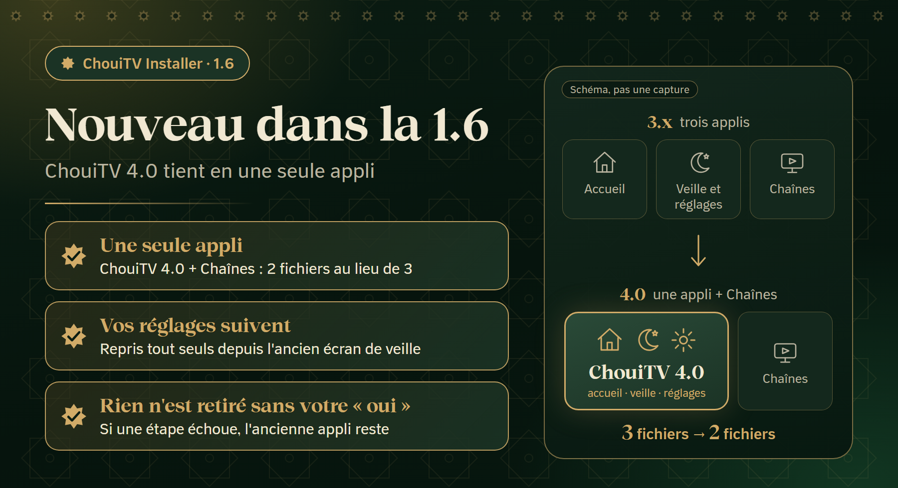
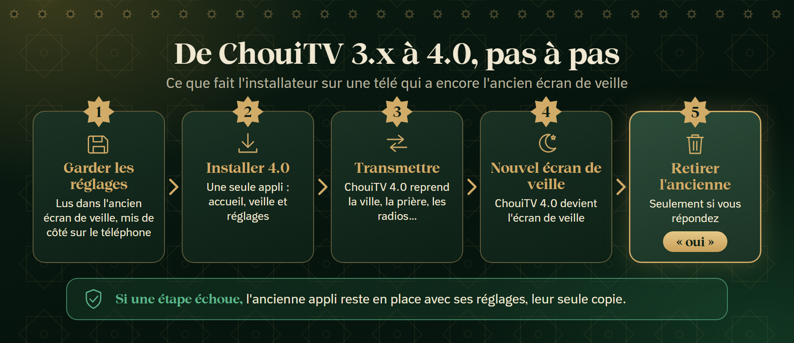

<p align="center"></p>

<p align="center"><a href="https://github.com/EMCHOUIT/ChouiTV-Installer/releases/latest/download/ChouiTV-Installer.apk"></a></p>

<p align="center"><a href="README.md">🇲🇦 العربية</a> &nbsp;·&nbsp; <b>🇫🇷 Français</b> &nbsp;·&nbsp; <a href="README.en.md">🇬🇧 English</a></p>

<p align="center">
<a href="https://github.com/EMCHOUIT/ChouiTV-Installer/releases/latest"></a>

<a href="LICENSE"></a>
<a href="https://github.com/EMCHOUIT/ChouiTV-Installer/stargazers"></a>
</p>

<p align="center"><a href="#new">🆕 Nouveau</a> · <a href="#why">✨ Pourquoi</a> · <a href="#journey">🚀 Le parcours</a> · <a href="#installs">📦 Installé</a> · <a href="#safety">🛡️ Sécurité</a> · <a href="#cleanup">🧹 Nettoyage</a> · <a href="#settings">🔁 Réglages</a> · <a href="#migration">🔄 Vers la 4.0</a> · <a href="#faq">❓ FAQ</a> · <a href="#build">🛠️ Compiler</a> · <a href="#versions">📜 Versions</a> · <a href="#download">⬇️ Téléchargement</a></p>

Une petite appli sur votre téléphone qui trouve votre télé, la nettoie si vous le voulez, télécharge la **dernière version** de [ChouiTV](https://github.com/EMCHOUIT/ChouiTV), l'installe et la règle, puis copie vos réglages sur une autre télé. **Elle vous guide pas à pas, ou vous choisissez vous-même. Sans ordinateur, sans commande.**

<p align="center"><a href="https://github.com/EMCHOUIT/ChouiTV-Installer/releases/latest/download/ChouiTV-Installer.apk"></a><br><sub>Pour téléphone Android 8 ou plus · environ 1 Mo</sub></p>

<a id="new"></a>

## 🆕 Nouveau dans la 1.6



- **ChouiTV 4.0 tient en une seule appli** : accueil, écran de veille et réglages. L'installateur pose donc **une appli + Chaînes** (2 fichiers au lieu de 3).
- **Si votre télé a encore l'ancien écran de veille**, ses réglages sont gardés puis repris dans la 4.0, et l'ancienne appli n'est retirée qu'après votre « oui » ([détails](#migration)).
- **Une confiance plus stricte** (1.4 et 1.5) : contrôle obligatoire de chaque fichier, et fichier de version signé par le propriétaire ([Sécurité](#safety)).
- **Les radios** voyagent avec les autres réglages : pays, stations décochées et favorites.

<a id="why"></a>

## ✨ Pourquoi cette appli ?

<table>
<tr><td width="50%" valign="top">🧭<br><b>Guidé ou libre</b><br><sub>Un assistant pas à pas, ou cinq espaces à ouvrir directement.</sub></td><td width="50%" valign="top">🧹<br><b>Un nettoyage que vous contrôlez</b><br><sub>Une case par appli, avec des noms lisibles, et rien sans votre accord.</sub></td></tr>
<tr><td width="50%" valign="top">🔁<br><b>Vos réglages voyagent</b><br><sub>Enregistrez les réglages d'une télé sous un nom, envoyez-les à une autre, maintenant ou plus tard.</sub></td><td width="50%" valign="top">🛡️<br><b>Tout est annulable</b><br><sub>Les applis sont coupées, pas supprimées, avec un filet de sécurité sur la télé.</sub></td></tr>
</table>

<a id="journey"></a>

## 🚀 Le parcours en cinq écrans


1. **Langue** : arabe, français ou anglais.
2. **Le mode** : « Je me laisse guider » (un assistant pas à pas, avec reprise si vous quittez) ou « Je choisis moi-même ».
3. **Le parcours ou les espaces** : « Équiper ma télé », « Copier d'une télé à l'autre », « Envoyer des réglages enregistrés », « Remettre une appli », ou les cinq espaces directement.
4. **Le nettoyage** : vous voyez le plan avant tout changement et vous cochez ce que vous n'utilisez pas.
5. **Installation et réglages** : une barre avec pourcentage, puis ville, fuseau horaire et méthode de prière.

L'installation elle-même tient en deux étapes : **ChouiTV**, puis **Chaînes**. Si la télé a encore l'ancien écran de veille, s'y ajoute la [reprise des réglages](#migration).

<a id="installs"></a>

## 📦 Ce qui est installé

| Application | Son rôle | Taille |
|---|---|---|
| **ChouiTV 4.0** (`ma.chouitv.home`) | une seule appli : l'écran d'accueil avec prière, écoute et dhikr, l'écran de veille (dhikr, tasbih guidé, sagesse de l'histoire) et les réglages | environ 3,5 Mo |
| **Application Chaînes** | 311 chaînes arabes en direct | |

ChouiTV 3.x se composait de deux applis (l'accueil et l'écran de veille), et l'installateur posait donc trois fichiers. Depuis la 4.0, elles n'en font plus qu'une : l'installation compte **deux fichiers**.

L'appli lit la version dans [`latest.json`](https://raw.githubusercontent.com/EMCHOUIT/ChouiTV/main/latest.json) : elle installe donc toujours la **dernière version** sans être recompilée, après les contrôles décrits plus bas. Un ancien fichier de version qui liste encore deux applis ChouiTV (accueil et écran de veille) reste accepté : la ligne de l'écran de veille est ignorée.

<a id="safety"></a>

## 🛡️ Sécurité

### Ce que l'installateur vérifie avant de toucher à votre télé (1.4 et 1.5)

1. **Le fichier de version est signé** (1.5) : l'installateur ne croit un `latest.json` que si sa signature `latest.json.sig` correspond à la clé publique du propriétaire, intégrée à l'appli. Qui pirate le compte GitHub ne peut donc pas l'envoyer ailleurs : la signature est faite sur l'ordinateur du propriétaire, pas sur GitHub. Un fichier de version plus ancien que le minimum (version 180 de ChouiTV) est refusé, pour qu'on ne ramène pas une télé vers une version au défaut connu.
2. **Adresses ChouiTV seulement** : les fichiers ne viennent que de la page des versions de ChouiTV sur GitHub, en https ; une adresse qui contient de quoi la détourner est refusée.
3. **Empreinte SHA-256 obligatoire** pour chaque fichier : pas de fichier sans empreinte, pas de fichier qui ne la respecte pas.
4. **L'appli ChouiTV est contrôlée sur le téléphone avant l'envoi** : est-ce la bonne appli, dans la version annoncée, signée avec la clé de ChouiTV ? Sinon le fichier est supprimé et rien n'est envoyé.
5. **La version est revérifiée sur la télé après l'installation**, et chaque appli est retentée **une seule fois** en cas d'échec.
6. **Pas de retrait sans question** : si une appli du même nom est déjà sur la télé mais signée avec une autre clé, l'installateur vous demande avant de la retirer ; ses réglages sont gardés de côté et remis ensuite, autant que possible.

**Ce qui n'est pas vérifié, dit franchement :**

- **L'appli Chaînes** est un build tiers gardé tel quel : seule son empreinte est contrôlée (SHA-256 du fichier de version, ou empreinte fixée dans l'installateur), ni sa clé de signature ni son numéro de version.
- **Le contenu des applis ChouiTV** n'est pas audité par l'installateur : il s'assure qu'elles viennent du propriétaire et sont telles que publiées, pas qu'elles sont sans défaut.
- **Une clé volée n'est pas couverte** : qui détient la clé de signature du propriétaire, ou son ordinateur, peut signer un fichier de version.
- **Le fichier de l'installateur lui-même** se vérifie de votre côté : voir [Vérifier le fichier](#download).

### Sur la télé elle-même

- **Filet de sécurité** : avant de couper l'accueil d'origine, l'appli arme sur la télé un script qui le rétablit tout seul au bout de 5 minutes si ChouiTV ne s'ouvre pas.
- **Respect de votre télé** : si elle refuse de couper son accueil (comme la Nokia Streaming Box 8000), il est conservé et vous en êtes informé.
- **Nettoyage sans risque** : il est facultatif, il coupe sans supprimer, vérifie la télé après chaque groupe et remet tout en place si elle va mal ; l'espace « Réactiver des applis » remet une appli à la demande.
- **Vie privée** : pas de compte, pas de publicité, pas de suivi ; la clé qui identifie votre téléphone y reste.

> [!TIP]
> **Une fois fini** : désactivez le « Débogage réseau » sur la télé.


<a id="cleanup"></a>

## 🧹 Nettoyez votre télé en sécurité


Certaines télés (Xiaomi, TCL, etc.) arrivent avec des applis préinstallées dont vous n'avez pas besoin : suivi, statistiques, publicités, services qui ralentissent l'appareil. Vous avez aussi peut-être des applis qui démarrent avec la télé sans que vous les utilisiez. **Le nettoyage est facultatif, et c'est vous qui décidez.**

- **Une case par appli** : « Applis préinstallées » (cochées d'avance), « Streaming et divertissement » (Netflix, Prime Video… décochées) et « Vos applis installées », avec un conseil pour celles qui démarrent avec la télé et la ralentissent.
- **Des noms lisibles** : le nom de l'appli, son paquet en dessous.
- **Une confirmation avant de commencer** : vous relisez la liste et laissez décochées celles que vous utilisez, elles restent intactes.
- **On coupe, on ne supprime pas** : la télé est vérifiée après chaque groupe, remise en place si elle va mal, et si la connexion est perdue elle remet tout d'elle-même au bout de 5 minutes.
- **Toujours protégé** : ChouiTV, les services Google, les réglages et tout écran d'accueil.
- **Remettez une appli quand vous voulez** : l'espace « Réactiver des applis » lit ce qui est coupé sur la télé elle-même.

<a id="settings"></a>

## 🔁 Copiez vos réglages sur une autre télé


Utilisez les espaces **Récupérer des réglages** et **Envoyer des réglages** (ou le parcours guidé « Copier d'une télé à l'autre »).

- **Enregistrez sous un nom** : les réglages de la télé connectée (ville, prière, adhan, panneaux, équipes, raccourcis de l'accueil, radios : pays, stations décochées et favorites…) sont gardés sur votre téléphone, nulle part ailleurs.
- **Envoyez maintenant ou plus tard** : si les deux télés sont ensemble, envoyez tout de suite ; sinon emportez les réglages et envoyez-les depuis « Envoyer des réglages enregistrés ».
- **Aperçu et annulation** : vous voyez les changements avant de les appliquer, et l'envoi garde une copie des réglages précédents.
- **Jamais enregistré** : l'adresse IP ou le nom du Wi-Fi, le numéro de série, vos photos et vos tâches.

ChouiTV 3.173 ou plus est nécessaire sur les deux télés.

<a id="migration"></a>

## 🔄 Passer de ChouiTV 3.x à la 4.0



Si votre télé a l'ancienne appli d'écran de veille (`ma.chouitv.screensaver`), vous n'avez rien à faire vous-même. L'installateur procède dans cet ordre :

1. **Il garde les réglages** : il lit ceux de l'ancien écran de veille (ville, méthode de prière, radios…) et les met de côté dans l'espace privé de l'appli, sur votre téléphone.
2. **Il installe ChouiTV 4.0.**
3. **Il transmet les réglages** à la 4.0.
4. **Il choisit le nouvel écran de veille** : celui de la 4.0 devient l'écran de veille de la télé.
5. **Il vous demande** si l'ancienne appli doit être retirée (la garder ou la retirer). Rien n'est retiré sans votre « oui ».

**Ce qui reste en sécurité** : si les réglages n'ont pas pu être gardés, si la 4.0 les refuse, ou si vous ne répondez pas « oui », l'ancienne appli reste en place avec ses réglages, car elle en détient alors la seule copie. La copie temporaire est effacée du téléphone à la fin. Si la télé n'a pas l'ancienne appli, rien n'est repris.

Le résultat s'affiche sur l'écran de fin : « Réglages repris, ancienne appli retirée », « … ancienne appli conservée » ou « Reprise impossible : l'ancienne appli reste en place ».

<a id="faq"></a>

## ❓ Questions fréquentes

<details><summary><b>Je ne trouve pas ma télé dans la liste</b></summary>

Vérifiez que le téléphone et la télé sont sur le **même Wi-Fi** et que le « Débogage réseau » est activé sur la télé. Vous pouvez aussi saisir l'adresse de la télé à la main.
</details>

<details><summary><b>La fenêtre « Autoriser » n'apparaît pas sur la télé</b></summary>

L'appli attend deux minutes. Si la fenêtre n'apparaît pas, redémarrez la télé puis réessayez : une demande précédente est peut-être restée bloquée.
</details>

<details><summary><b>Le bouton Home n'ouvre pas ChouiTV</b></summary>

Certaines télés imposent leur accueil. L'appli vous le dit à la fin, et vous trouvez ChouiTV dans les applications de la télé. Dans tous les cas, la télé rétablit seule son accueil d'origine si le nouveau ne fonctionne pas.
</details>

<details><summary><b>Comment revenir en arrière ?</b></summary>

Réactivez l'accueil de la télé dans ses réglages, ou utilisez `optimize/reset.sh` de [ChouiTV](https://github.com/EMCHOUIT/ChouiTV).
</details>

<details><summary><b>Le nettoyage est-il sûr ?</b></summary>

Il est facultatif, il coupe sans supprimer, vous montre le plan d'abord et vérifie la télé après chaque groupe. Mais une appli coupée ne se met plus à jour, et une mise à jour du système peut en réactiver. Certaines télés perdraient leur Wi-Fi enregistré si l'assistant de configuration était coupé : il est donc protégé lui aussi.
</details>

<details><summary><b>Comment annuler un nettoyage ?</b></summary>

Ouvrez l'espace « Réactiver des applis » et cochez celles que vous voulez remettre : il lit ce qui est coupé sur la télé elle-même, n'importe quel téléphone peut donc le faire. Une copie en texte est aussi sur la télé : `/data/local/tmp/chouitv-restore.txt`.
</details>

<details><summary><b>Quelle différence entre « Je me laisse guider » et « Je choisis moi-même » ?</b></summary>

Le premier est un assistant qui vous dit quoi faire étape par étape et permet de reprendre si vous quittez. Le second ouvre directement les cinq espaces. Vous pouvez changer de mode à tout moment.
</details>

<details><summary><b>Comment copier mes réglages sur une autre télé ?</b></summary>

Avec « Copier d'une télé à l'autre » : vous enregistrez les réglages de la première télé sous un nom, puis vous les envoyez tout de suite si les deux télés sont ensemble, ou plus tard depuis « Envoyer des réglages enregistrés ». ChouiTV 3.173 ou plus est nécessaire sur les deux télés ; l'aperçu s'affiche avant d'appliquer et l'envoi peut s'annuler.
</details>

<details><summary><b>Je vois deux entrées du même nom dans la liste des économiseurs d'écran d'Android</b></summary>

Cela arrive si vous passez à la 4.0 à la main (en l'installant par-dessus, sans l'installateur) alors que l'ancien écran de veille est encore sur la télé : les deux applis proposent un écran de veille nommé ChouiTV. Choisissez le nouveau (4.0), puis retirez l'ancien dans les réglages de la télé, rubrique Applications. Avec l'installateur, c'est lui qui choisit le nouveau et vous demande s'il faut retirer l'ancien.
</details>

<details><summary><b>La télé ne répond plus pendant le passage à la 4.0</b></summary>

Si la connexion est perdue avant que quoi que ce soit soit gardé, la télé n'a pas changé. Si elle est perdue après l'installation de la 4.0, l'ancienne appli n'est pas retirée (elle ne l'est qu'après votre « oui ») : redémarrez la télé, rouvrez l'installateur et relancez l'opération ; tant que l'ancienne appli est là, il retente la reprise. Vérifiez que le téléphone et la télé sont sur le même Wi-Fi et que le « Débogage réseau » est activé.
</details>

<details><summary><b>La reprise des réglages a échoué : que devient l'ancienne appli ?</b></summary>

Elle reste en place avec ses réglages, et il ne vous est même pas proposé de la retirer : elle détient la seule copie. L'écran de fin indique « Reprise impossible : l'ancienne appli reste en place ». Vous pouvez réessayer depuis « Équiper ma télé », régler la 4.0 à la main, ou envoyer des réglages enregistrés depuis « Envoyer des réglages enregistrés ».
</details>

<details><summary><b>Trois fichiers ou deux ? Où est l'appli d'écran de veille ?</b></summary>

Depuis la 4.0, l'écran d'accueil, l'écran de veille et les réglages forment une seule appli (`ma.chouitv.home`), et l'installateur ne pose que celle-ci et l'appli Chaînes. L'écran de veille est dans l'appli : choisissez-le dans les réglages de la télé, rubrique Écran de veille, si l'installateur ne l'a pas fait.
</details>

<a id="build"></a>

## 🛠️ Compiler

JDK 17 et Android SDK (plateforme 34) :

```bash
git clone https://github.com/EMCHOUIT/ChouiTV-Installer
cd ChouiTV-Installer
./gradlew :app:assembleRelease      # le fichier est dans app/build/outputs/apk/release
./gradlew :app:testDebugUnitTest    # 108 tests sur la JVM
```

Version actuelle : **1.6** (`versionCode 9`), pour Android 8 ou plus (`minSdk 26`).

Les images dessinées de `docs/media` (carte « Nouveau », schéma de passage à la 4.0, numéro de version de la bannière, QR code) se refont avec `python docs/media/build_media.py` (Pillow et Edge ou Chrome requis) ; les captures du téléphone, elles, sont réelles et ne sont pas générées.

<a id="versions"></a>

## 📜 Versions

| Version | Ce qui change |
|---|---|
| **1.6** | ChouiTV 4.0 est une seule appli : l'installateur pose une appli + Chaînes ; reprise des réglages de l'ancien écran de veille, retrait seulement après un « oui » ; les radios font partie des réglages enregistrés |
| **1.5** | le fichier de version doit être signé par le propriétaire (`latest.json.sig`) |
| **1.4** | confiance : empreinte obligatoire, adresses ChouiTV seulement, chaque appli contrôlée sur le téléphone (appli, version, clé) puis sur la télé, une seule nouvelle tentative, question avant de retirer une appli signée avec une autre clé |
| **1.3** | bouton d'actualisation, marque et modèle dans la liste des télés, un écran de fin unique pour chaque opération |
| **1.2** | deux modes (guidé ou libre), cinq espaces, nettoyage avec une case par appli, copie des réglages entre télés |

<a id="download"></a>

<h2 align="center">⬇️ Téléchargement direct</h2>

<p align="center"><br><sub>Scannez depuis votre ordinateur pour ouvrir le lien sur votre téléphone.</sub></p>

<p align="center"><a href="https://github.com/EMCHOUIT/ChouiTV-Installer/releases/latest/download/ChouiTV-Installer.apk"></a><br><sub><code>ChouiTV-Installer.apk</code> · environ 1 Mo</sub></p>

<p align="center"><a href="https://github.com/EMCHOUIT/ChouiTV-Installer/releases/latest"></a> <a href="https://github.com/EMCHOUIT/ChouiTV-Installer/releases"></a></p>

<p align="center">📱 Android 8 ou plus &nbsp;·&nbsp; 🔒 Signé, sans compte ni publicité &nbsp;·&nbsp; 📦 <a href="https://github.com/EMCHOUIT/ChouiTV-Installer/releases">Toutes les versions</a></p>

<h3 align="center">Installer en trois gestes</h3>

<table align="center">
<tr><td width="33%" valign="top" align="center">1️⃣<br><br><b>Téléchargez</b> le fichier <code>ChouiTV-Installer.apk</code> sur votre téléphone (le bouton ci-dessus, ou le QR code depuis un autre écran).</td><td width="33%" valign="top" align="center">2️⃣<br><br><b>Ouvrez-le.</b> Si Android demande une autorisation, acceptez une fois que votre navigateur ou votre gestionnaire de fichiers installe des applis. Un avertissement « appli inconnue » peut apparaître : le code est ouvert et vous pouvez le compiler vous-même (<a href="#build">Compiler</a>).</td><td width="33%" valign="top" align="center">3️⃣<br><br><b>Ouvrez ChouiTV Installer</b> et suivez les étapes.</td></tr>
</table>

<div align="center">

<details><summary><b>🔍 Vérifier le fichier</b></summary>

Le lien direct télécharge toujours la **dernière version**. Sur la [page de la version](https://github.com/EMCHOUIT/ChouiTV-Installer/releases/latest), le même fichier existe aussi sous un nom qui porte le numéro (par exemple `ChouiTV-Installer-1.6.apk`). La page affiche l'empreinte SHA-256 à côté du fichier. Comparez-la au résultat de :

```bash
sha256sum ChouiTV-Installer.apk                       # Linux, macOS
certutil -hashfile ChouiTV-Installer.apk SHA256       # Windows
```

L'empreinte du certificat de signature (SHA-256) est la même pour toutes les versions :

```text
f29f993b7456170455dcc574a2bc5f1f74b97f7995a564f8a839175d068a79c1
```

Pour la vérifier :

```bash
apksigner verify --print-certs ChouiTV-Installer.apk
```
</details>

</div>

## 💚 Crédits et licence

Licence **MIT** (EMChouit). Les polices et leurs licences : [THIRD_PARTY_NOTICES.md](THIRD_PARTY_NOTICES.md). Les applis installées sont celles de [ChouiTV](https://github.com/EMCHOUIT/ChouiTV). **Le projet vous plaît ? Mettez-lui une étoile ⭐, ça nous encourage à continuer.**
