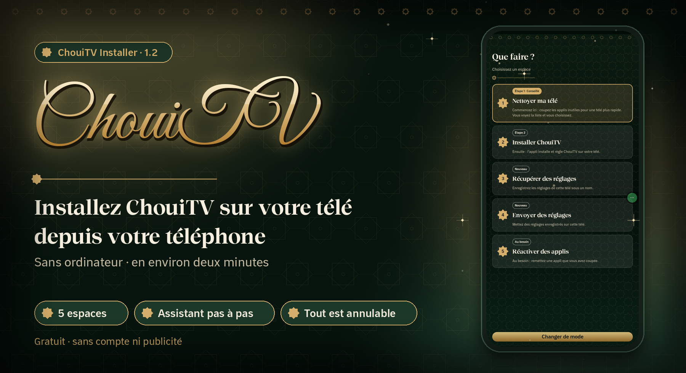
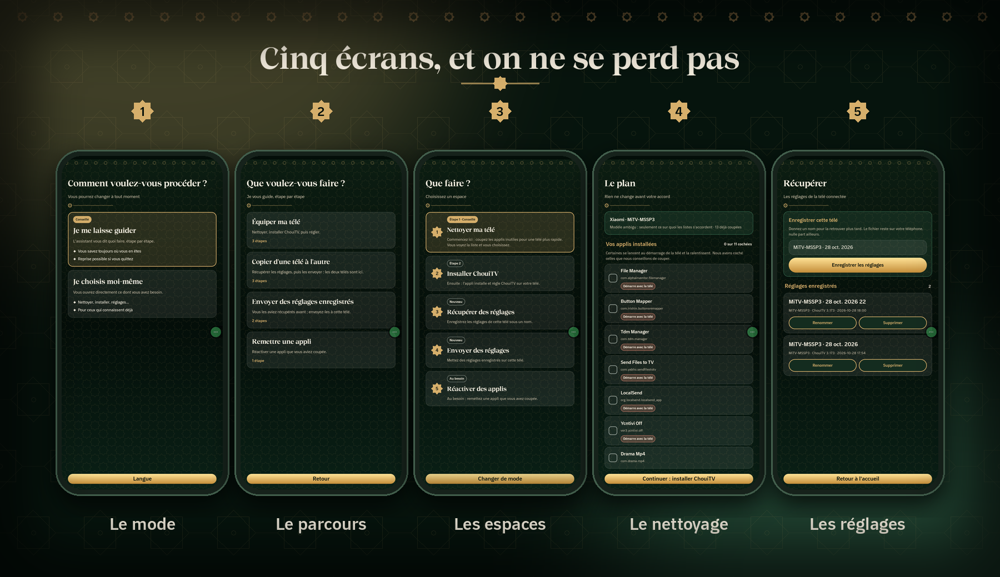
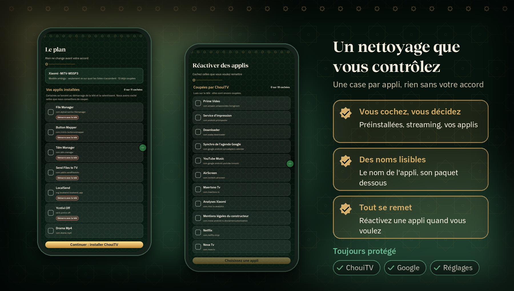
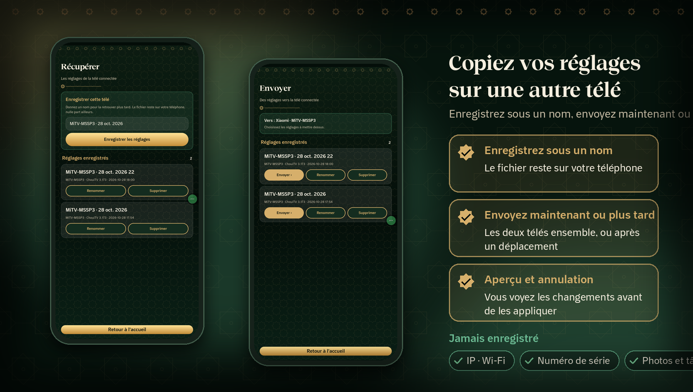

<p align="center"></p>

<p align="center"><a href="https://github.com/EMCHOUIT/ChouiTV-Installer/releases/latest/download/ChouiTV-Installer.apk"></a></p>

<p align="center"><a href="README.md">🇲🇦 العربية</a> &nbsp;·&nbsp; <b>🇫🇷 Français</b> &nbsp;·&nbsp; <a href="README.en.md">🇬🇧 English</a></p>

<p align="center">
<a href="https://github.com/EMCHOUIT/ChouiTV-Installer/releases/latest"></a>

<a href="LICENSE"></a>
<a href="https://github.com/EMCHOUIT/ChouiTV-Installer/stargazers"></a>
</p>

<p align="center"><a href="#why">✨ Pourquoi</a> · <a href="#journey">🚀 Le parcours</a> · <a href="#installs">📦 Installé</a> · <a href="#safety">🛡️ Sécurité</a> · <a href="#cleanup">🧹 Nettoyage</a> · <a href="#settings">🔁 Réglages</a> · <a href="#faq">❓ FAQ</a> · <a href="#build">🛠️ Compiler</a> · <a href="#download">⬇️ Téléchargement</a></p>

Une petite appli sur votre téléphone qui trouve votre télé, la nettoie si vous le voulez, télécharge la **dernière version** de [ChouiTV](https://github.com/EMCHOUIT/ChouiTV), l'installe et la règle, puis copie vos réglages sur une autre télé. **Elle vous guide pas à pas, ou vous choisissez vous-même. Sans ordinateur, sans commande.**

<p align="center"><a href="https://github.com/EMCHOUIT/ChouiTV-Installer/releases/latest/download/ChouiTV-Installer.apk"></a><br><sub>Pour téléphone Android 8 ou plus · environ 1 Mo</sub></p>

<a id="why"></a>

## ✨ Pourquoi cette appli ?

<table>
<tr><td width="50%" valign="top">🧭<br><b>Guidé ou libre</b><br><sub>Un assistant pas à pas, ou cinq espaces à ouvrir directement.</sub></td><td width="50%" valign="top">🧹<br><b>Un nettoyage que vous contrôlez</b><br><sub>Une case par appli, avec des noms lisibles, et rien sans votre accord.</sub></td></tr>
<tr><td width="50%" valign="top">🔁<br><b>Vos réglages voyagent</b><br><sub>Enregistrez les réglages d'une télé sous un nom, envoyez-les à une autre, maintenant ou plus tard.</sub></td><td width="50%" valign="top">🛡️<br><b>Tout est annulable</b><br><sub>Les applis sont coupées, pas supprimées, avec un filet de sécurité sur la télé.</sub></td></tr>
</table>

<a id="journey"></a>

## 🚀 Le parcours en cinq écrans



1. **Langue** : arabe, français ou anglais.
2. **Le mode** : « Je me laisse guider » (un assistant pas à pas, avec reprise si vous quittez) ou « Je choisis moi-même ».
3. **Le parcours ou les espaces** : « Équiper ma télé », « Copier d'une télé à l'autre », « Envoyer des réglages enregistrés », « Remettre une appli », ou les cinq espaces directement.
4. **Le nettoyage** : vous voyez le plan avant tout changement et vous cochez ce que vous n'utilisez pas.
5. **Installation et réglages** : une barre avec pourcentage, puis ville, fuseau horaire et méthode de prière.

<a id="installs"></a>

## 📦 Ce qui est installé

| Application | Son rôle |
|---|---|
| **Écran d'accueil** | le premier écran de la télé, avec prière, écoute et dhikr |
| **Écran de veille et réglages** | dhikr, tasbih guidé et sagesse de l'histoire |
| **Application Chaînes** | 311 chaînes arabes en direct |

L'appli lit la version dans [`latest.json`](https://raw.githubusercontent.com/EMCHOUIT/ChouiTV/main/latest.json) : elle installe donc toujours la **dernière version** sans être recompilée, et vérifie l'empreinte SHA-256 de chaque fichier avant de l'envoyer.

<a id="safety"></a>

## 🛡️ Sécurité

- **Filet de sécurité** : avant de couper l'accueil d'origine, l'appli arme sur la télé un script qui le rétablit tout seul au bout de 5 minutes si ChouiTV ne s'ouvre pas.
- **Respect de votre télé** : si elle refuse de couper son accueil (comme la Nokia Streaming Box 8000), il est conservé et vous en êtes informé.
- **Nettoyage sans risque** : il est facultatif, il coupe sans supprimer, vérifie la télé après chaque groupe et remet tout en place si elle va mal ; l'espace « Réactiver des applis » remet une appli à la demande.
- **Vie privée** : pas de compte, pas de publicité, pas de suivi ; la clé qui identifie votre téléphone y reste.

> [!TIP]
> **Une fois fini** : désactivez le « Débogage réseau » sur la télé.


<a id="cleanup"></a>

## 🧹 Nettoyez votre télé en sécurité



Certaines télés (Xiaomi, TCL, etc.) arrivent avec des applis préinstallées dont vous n'avez pas besoin : suivi, statistiques, publicités, services qui ralentissent l'appareil. Vous avez aussi peut-être des applis qui démarrent avec la télé sans que vous les utilisiez. **Le nettoyage est facultatif, et c'est vous qui décidez.**

- **Une case par appli** : « Applis préinstallées » (cochées d'avance), « Streaming et divertissement » (Netflix, Prime Video… décochées) et « Vos applis installées », avec un conseil pour celles qui démarrent avec la télé et la ralentissent.
- **Des noms lisibles** : le nom de l'appli, son paquet en dessous.
- **Une confirmation avant de commencer** : vous relisez la liste et laissez décochées celles que vous utilisez, elles restent intactes.
- **On coupe, on ne supprime pas** : la télé est vérifiée après chaque groupe, remise en place si elle va mal, et si la connexion est perdue elle remet tout d'elle-même au bout de 5 minutes.
- **Toujours protégé** : ChouiTV, les services Google, les réglages et tout écran d'accueil.
- **Remettez une appli quand vous voulez** : l'espace « Réactiver des applis » lit ce qui est coupé sur la télé elle-même.

<a id="settings"></a>

## 🔁 Copiez vos réglages sur une autre télé



Utilisez les espaces **Récupérer des réglages** et **Envoyer des réglages** (ou le parcours guidé « Copier d'une télé à l'autre »).

- **Enregistrez sous un nom** : les réglages de la télé connectée (ville, prière, adhan, panneaux, équipes, raccourcis de l'accueil…) sont gardés sur votre téléphone, nulle part ailleurs.
- **Envoyez maintenant ou plus tard** : si les deux télés sont ensemble, envoyez tout de suite ; sinon emportez les réglages et envoyez-les depuis « Envoyer des réglages enregistrés ».
- **Aperçu et annulation** : vous voyez les changements avant de les appliquer, et l'envoi garde une copie des réglages précédents.
- **Jamais enregistré** : l'adresse IP ou le nom du Wi-Fi, le numéro de série, vos photos et vos tâches.

ChouiTV 3.173 ou plus est nécessaire sur les deux télés.

<a id="faq"></a>

## ❓ Questions fréquentes

<details><summary><b>Je ne trouve pas ma télé dans la liste</b></summary>

Vérifiez que le téléphone et la télé sont sur le **même Wi-Fi** et que le « Débogage réseau » est activé sur la télé. Vous pouvez aussi saisir l'adresse de la télé à la main.
</details>

<details><summary><b>La fenêtre « Autoriser » n'apparaît pas sur la télé</b></summary>

L'appli attend deux minutes. Si la fenêtre n'apparaît pas, redémarrez la télé puis réessayez : une demande précédente est peut-être restée bloquée.
</details>

<details><summary><b>Le bouton Home n'ouvre pas ChouiTV</b></summary>

Certaines télés imposent leur accueil. L'appli vous le dit à la fin, et vous trouvez ChouiTV dans les applications de la télé. Dans tous les cas, la télé rétablit seule son accueil d'origine si le nouveau ne fonctionne pas.
</details>

<details><summary><b>Comment revenir en arrière ?</b></summary>

Réactivez l'accueil de la télé dans ses réglages, ou utilisez `optimize/reset.sh` de [ChouiTV](https://github.com/EMCHOUIT/ChouiTV).
</details>

<details><summary><b>Le nettoyage est-il sûr ?</b></summary>

Il est facultatif, il coupe sans supprimer, vous montre le plan d'abord et vérifie la télé après chaque groupe. Mais une appli coupée ne se met plus à jour, et une mise à jour du système peut en réactiver. Certaines télés perdraient leur Wi-Fi enregistré si l'assistant de configuration était coupé : il est donc protégé lui aussi.
</details>

<details><summary><b>Comment annuler un nettoyage ?</b></summary>

Ouvrez l'espace « Réactiver des applis » et cochez celles que vous voulez remettre : il lit ce qui est coupé sur la télé elle-même, n'importe quel téléphone peut donc le faire. Une copie en texte est aussi sur la télé : `/data/local/tmp/chouitv-restore.txt`.
</details>

<details><summary><b>Quelle différence entre « Je me laisse guider » et « Je choisis moi-même » ?</b></summary>

Le premier est un assistant qui vous dit quoi faire étape par étape et permet de reprendre si vous quittez. Le second ouvre directement les cinq espaces. Vous pouvez changer de mode à tout moment.
</details>

<details><summary><b>Comment copier mes réglages sur une autre télé ?</b></summary>

Avec « Copier d'une télé à l'autre » : vous enregistrez les réglages de la première télé sous un nom, puis vous les envoyez tout de suite si les deux télés sont ensemble, ou plus tard depuis « Envoyer des réglages enregistrés ». ChouiTV 3.173 ou plus est nécessaire sur les deux télés ; l'aperçu s'affiche avant d'appliquer et l'envoi peut s'annuler.
</details>

<a id="build"></a>

## 🛠️ Compiler

JDK 17 et Android SDK (plateforme 34) :

```bash
git clone https://github.com/EMCHOUIT/ChouiTV-Installer
cd ChouiTV-Installer
./gradlew :app:assembleRelease
```

<a id="download"></a>

<h2 align="center">⬇️ Téléchargement direct</h2>

<p align="center"><br><sub>Scannez depuis votre ordinateur pour ouvrir le lien sur votre téléphone.</sub></p>

<p align="center"><a href="https://github.com/EMCHOUIT/ChouiTV-Installer/releases/latest/download/ChouiTV-Installer.apk"></a><br><sub><code>ChouiTV-Installer.apk</code> · environ 1 Mo</sub></p>

<p align="center"><a href="https://github.com/EMCHOUIT/ChouiTV-Installer/releases/latest"></a> <a href="https://github.com/EMCHOUIT/ChouiTV-Installer/releases"></a></p>

<p align="center">📱 Android 8 ou plus &nbsp;·&nbsp; 🔒 Signé, sans compte ni publicité &nbsp;·&nbsp; 📦 <a href="https://github.com/EMCHOUIT/ChouiTV-Installer/releases">Toutes les versions</a></p>

<h3 align="center">Installer en trois gestes</h3>

<table align="center">
<tr><td width="33%" valign="top" align="center">1️⃣<br><br><b>Téléchargez</b> le fichier <code>ChouiTV-Installer.apk</code> sur votre téléphone (le bouton ci-dessus, ou le QR code depuis un autre écran).</td><td width="33%" valign="top" align="center">2️⃣<br><br><b>Ouvrez-le.</b> Si Android demande une autorisation, acceptez une fois que votre navigateur ou votre gestionnaire de fichiers installe des applis. Un avertissement « appli inconnue » peut apparaître : le code est ouvert et vous pouvez le compiler vous-même (<a href="#build">Compiler</a>).</td><td width="33%" valign="top" align="center">3️⃣<br><br><b>Ouvrez ChouiTV Installer</b> et suivez les étapes.</td></tr>
</table>

<div align="center">

<details><summary><b>🔍 Vérifier le fichier</b></summary>

La [page de la version](https://github.com/EMCHOUIT/ChouiTV-Installer/releases/latest) affiche l'empreinte SHA-256 à côté du fichier. Comparez-la au résultat de :

```bash
sha256sum ChouiTV-Installer.apk                       # Linux, macOS
certutil -hashfile ChouiTV-Installer.apk SHA256       # Windows
```

L'empreinte du certificat de signature (SHA-256) est la même pour toutes les versions :

```text
f29f993b7456170455dcc574a2bc5f1f74b97f7995a564f8a839175d068a79c1
```

Pour la vérifier :

```bash
apksigner verify --print-certs ChouiTV-Installer.apk
```
</details>

</div>

## 💚 Crédits et licence

Licence **MIT** (EMChouit). Les polices et leurs licences : [THIRD_PARTY_NOTICES.md](THIRD_PARTY_NOTICES.md). Les applis installées sont celles de [ChouiTV](https://github.com/EMCHOUIT/ChouiTV). **Le projet vous plaît ? Mettez-lui une étoile ⭐, ça nous encourage à continuer.**
