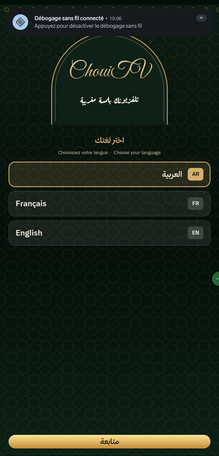
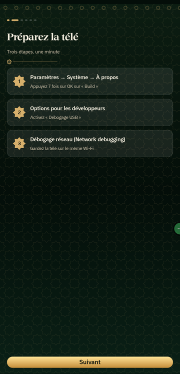
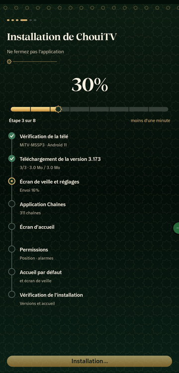
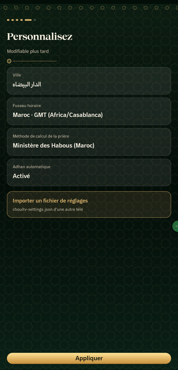
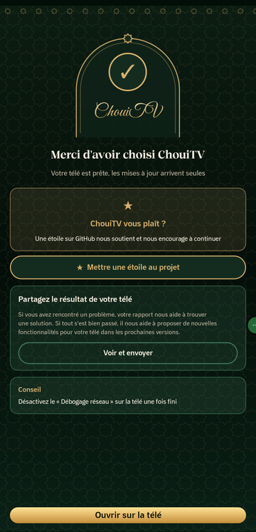
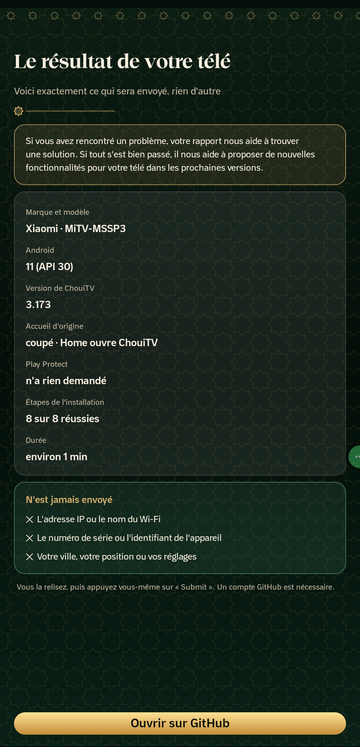

<p align="center"><b>🇲🇦 العربية</b> · <a href="README.fr.md">🇫🇷 Français</a> · <a href="README.en.md">🇬🇧 English</a></p>

<h1 align="center">ChouiTV Installer</h1>

<p align="center"><b>ثبّت ChouiTV على تلفزيونك من هاتفك، بلا كمبيوتر.</b></p>

<p align="center">
<a href="https://github.com/EMCHOUIT/ChouiTV-Installer/releases/latest"></a>

<a href="LICENSE"></a>
</p>

<div dir="rtl" align="right">

## ✨ ما هو؟

تطبيق أندرويد للهاتف يجد تلفزيونك على الواي فاي، وينزّل **أحدث إصدار** من [ChouiTV](https://github.com/EMCHOUIT/ChouiTV)، ويثبّته ويضبطه، في نحو دقيقتين، بلا كمبيوتر ولا أوامر.

## 🖼️ لقطات

<table><tr><td align="center"></td><td align="center"></td><td align="center"></td><td align="center"></td><td align="center"></td><td align="center"></td></tr></table>

## ⬇️ التحميل

نزّل [**ChouiTV-Installer.apk**](https://github.com/EMCHOUIT/ChouiTV-Installer/releases/latest/download/ChouiTV-Installer.apk) على هاتف أندرويد (8 أو أحدث) ثم افتحه. قد يطلب الهاتف السماح بالتثبيت من هذا المصدر.

## 🚀 كيف يعمل

1. **اللغة**: العربية أو الفرنسية أو الإنجليزية.
2. **جهّز التلفزيون**: فعّل «تصحيح USB» و«تصحيح الشبكة» (الشرح في التطبيق).
3. **اتصل**: يجد التطبيق التلفزيون على الواي فاي، وتضغط «السماح» على شاشة التلفزيون.
4. **ثبّت**: شريط تقدّم بالنسبة المئوية وخطوات من 8 مراحل، من الفحص إلى التحقق.
5. **خصّص**: المدينة والمنطقة الزمنية (Africa/Casablanca) وطريقة حساب الصلاة، أو استورد ملف إعدادات.
6. **تمّ**: شكرًا لك، وطلب نجمة على GitHub، وخيار مشاركة نتيجة تلفزيونك.

## 📦 ماذا يثبّت؟

**الواجهة الرئيسية** و**شاشة التوقف والإعدادات** و**تطبيق القنوات** (311 قناة)، ثم يجعل ChouiTV واجهة التلفزيون الافتراضية. يقرأ الإصدار من [`latest.json`](https://raw.githubusercontent.com/EMCHOUIT/ChouiTV/main/latest.json) ويتحقق من بصمة SHA-256 لكل ملف.

## 🛡️ أمان

- **شبكة أمان**: قبل تعطيل واجهة التلفزيون الأصلية، يضع التطبيق على التلفزيون سكربتًا يعيدها وحده بعد 5 دقائق إن لم يفتح ChouiTV.
- إن رفض التلفزيون تعطيل واجهته (مثل Nokia Streaming Box 8000) تبقى كما هي ويُخبَر المستخدم.
- بلا حسابات ولا إعلانات ولا تتبّع. المفتاح الذي يعرّف هاتفك يبقى في الهاتف.
- أغلق «تصحيح الشبكة» على التلفزيون عند الانتهاء.

## 📮 شارك نتيجة تلفزيونك

في النهاية يمكنك مشاركة نتيجة تلفزيونك. **إن واجهتك مشكلة** فتقريرك يساعدنا على إيجاد حل. **وإن سار كل شيء على ما يرام** فيساعدنا على اقتراح ميزات جديدة لتلفزيونك في الإصدارات القادمة. تُعرض عليك **المعلومات كاملة قبل الإرسال** (العلامة والطراز، أندرويد، إصدارات التطبيق، نتيجة الخطوات)، ولا يُرسل **أبدًا** عنوان IP أو اسم الواي فاي أو الرقم التسلسلي أو مدينتك. وأنت من يضغط «Submit». القائمة في [التلفزيونات المجرَّبة](https://github.com/EMCHOUIT/ChouiTV/blob/main/docs/TESTED-TVS.md).

## 🛠️ البناء

JDK 17 وAndroid SDK (المنصة 34):

```bash
git clone https://github.com/EMCHOUIT/ChouiTV-Installer
cd ChouiTV-Installer
./gradlew :app:assembleRelease
```

## 💚 الشكر والترخيص

ترخيص **MIT** (EMChouit). الخطوط وتراخيصها في [THIRD_PARTY_NOTICES.md](THIRD_PARTY_NOTICES.md). التطبيقات المثبَّتة هي [ChouiTV](https://github.com/EMCHOUIT/ChouiTV).

</div>
