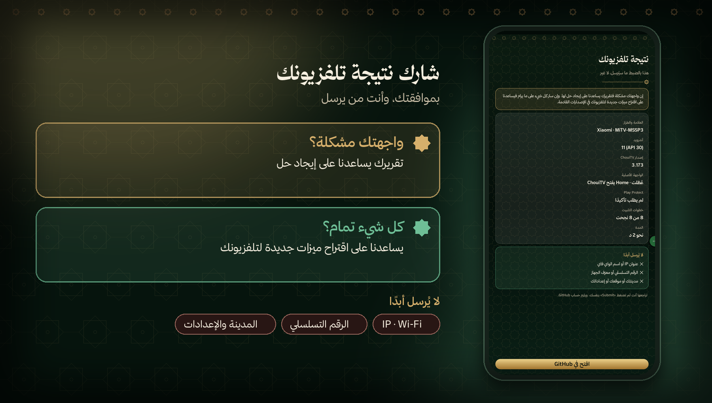

<p align="center"><a href="https://github.com/EMCHOUIT/ChouiTV-Installer/releases/latest/download/ChouiTV-Installer.apk"></a></p>

<p align="center"><b>🇲🇦 العربية</b> &nbsp;·&nbsp; <a href="README.fr.md">🇫🇷 Français</a> &nbsp;·&nbsp; <a href="README.en.md">🇬🇧 English</a></p>

<p align="center">
<a href="https://github.com/EMCHOUIT/ChouiTV-Installer/releases/latest"></a>

<a href="LICENSE"></a>
<a href="https://github.com/EMCHOUIT/ChouiTV-Installer/stargazers"></a>
</p>

<p align="center"><a href="#why">✨ لماذا</a> · <a href="#journey">🚀 الرحلة</a> · <a href="#installs">📦 ما يثبّته</a> · <a href="#safety">🛡️ الأمان</a> · <a href="#report">📮 التقرير</a> · <a href="#faq">❓ أسئلة</a> · <a href="#build">🛠️ البناء</a></p>

<div dir="rtl" align="right">

تطبيق صغير على هاتفك يجد تلفزيونك، وينزّل **أحدث إصدار** من [ChouiTV](https://github.com/EMCHOUIT/ChouiTV)، ويثبّته ويضبطه. **بلا كمبيوتر، بلا أوامر، في نحو دقيقتين.**

<p align="center"><a href="https://github.com/EMCHOUIT/ChouiTV-Installer/releases/latest/download/ChouiTV-Installer.apk"></a><br><sub>لهاتف أندرويد 8 أو أحدث · الملف نحو 650 ك.ب</sub></p>

<a id="why"></a>

## ✨ لماذا هذا التطبيق؟

<table dir="rtl">
<tr><td width="50%" valign="top">💻<br><b>بلا كمبيوتر</b><br><sub>كل شيء من الهاتف: الاتصال والتنزيل والتثبيت والضبط.</sub></td><td width="50%" valign="top">📊<br><b>تتابع كل شيء</b><br><sub>نسبة مئوية عامة، وثماني خطوات تراها تتقدّم واحدة بعد الأخرى.</sub></td></tr>
<tr><td width="50%" valign="top">🛡️<br><b>بشبكة أمان</b><br><sub>إن لم تفتح الواجهة الجديدة، يعيد التلفزيون واجهته الأصلية وحده.</sub></td><td width="50%" valign="top">🌍<br><b>بلغتك</b><br><sub>العربية والفرنسية والإنجليزية، بنفس العناية.</sub></td></tr>
</table>

<a id="journey"></a>

## 🚀 الرحلة في خمس خطوات

</div>


<div dir="rtl" align="right">

1. **اللغة**: اختر العربية أو الفرنسية أو الإنجليزية.
2. **جهّز التلفزيون**: فعّل «تصحيح USB» و«تصحيح الشبكة»؛ الشرح داخل التطبيق.
3. **اتصل**: يجد التطبيق تلفزيونك على الواي فاي، وتضغط «السماح» على شاشته.
4. **ثبّت**: شريط تقدّم ونسبة مئوية وثماني مراحل، من الفحص إلى التحقق.
5. **خصّص ثم تمّ**: المدينة والمنطقة الزمنية وطريقة حساب الصلاة، ثم شكرٌ وخيار مشاركة النتيجة.

<a id="installs"></a>

## 📦 ماذا يثبّت؟

| التطبيق | دوره |
|---|---|
| **الواجهة الرئيسية** | شاشة التلفزيون الأولى، مع الصلاة والاستماع والأذكار |
| **شاشة التوقف والإعدادات** | الأذكار والتسبيح الموجَّه وحكمة من التاريخ |
| **تطبيق القنوات** | 311 قناة عربية مباشرة |

يقرأ التطبيق رقم الإصدار من [`latest.json`](https://raw.githubusercontent.com/EMCHOUIT/ChouiTV/main/latest.json)، فيثبّت دائمًا **آخر إصدار** دون أن يُعاد بناؤه، ويتحقق من بصمة SHA-256 لكل ملف قبل إرساله.

<a id="safety"></a>

## 🛡️ الأمان

- **شبكة أمان**: قبل تعطيل واجهة التلفزيون الأصلية يضع التطبيق عليه سكربتًا يعيدها وحده بعد 5 دقائق إن لم يفتح ChouiTV.
- **احترام تلفزيونك**: إن رفض تعطيل واجهته (مثل Nokia Streaming Box 8000) تبقى كما هي ويُخبَر المستخدم.
- **خصوصية**: بلا حسابات ولا إعلانات ولا تتبّع، والمفتاح الذي يعرّف هاتفك يبقى فيه.

</div>

> [!TIP]
> **عند الانتهاء**: أغلق «تصحيح الشبكة» على التلفزيون.

<div dir="rtl" align="right">


<a id="report"></a>

## 📮 شارك نتيجة تلفزيونك

</div>



<div dir="rtl" align="right">

في النهاية يمكنك مشاركة نتيجة تلفزيونك. **إن واجهتك مشكلة** فتقريرك يساعدنا على إيجاد حل. **وإن سار كل شيء على ما يرام** فيساعدنا على اقتراح ميزات جديدة لتلفزيونك في الإصدارات القادمة.

تراجع **كل ما سيُرسل قبل أن يُرسل** (العلامة والطراز، أندرويد، الإصدارات، نتيجة الخطوات)، ولا يُرسل **أبدًا** عنوان IP أو اسم الواي فاي أو الرقم التسلسلي أو مدينتك. وأنت من يضغط «Submit». القائمة في [التلفزيونات المجرَّبة](https://github.com/EMCHOUIT/ChouiTV/blob/main/docs/TESTED-TVS.md).

<a id="faq"></a>

## ❓ أسئلة

<details><summary><b>لا أجد تلفزيوني في القائمة</b></summary>

تأكد أن الهاتف والتلفزيون على **نفس الواي فاي** وأن «تصحيح الشبكة» مفعّل على التلفزيون. يمكنك أيضًا كتابة عنوان التلفزيون يدويًا.
</details>

<details><summary><b>لا تظهر نافذة «السماح» على التلفزيون</b></summary>

ينتظر التطبيق دقيقتين. إن لم تظهر النافذة، أعد تشغيل التلفزيون ثم حاول مرة أخرى: قد يكون طلب سابق عالقًا.
</details>

<details><summary><b>الزر Home لا يفتح ChouiTV</b></summary>

بعض التلفزيونات تفرض واجهتها. يخبرك التطبيق بذلك في النهاية، وتجد ChouiTV في قائمة التطبيقات. وفي كل حال يعيد التلفزيون واجهته الأصلية وحده إن لم تعمل الجديدة.
</details>

<details><summary><b>كيف أتراجع؟</b></summary>

أعد تفعيل واجهة التلفزيون من إعداداته، أو استعمل `optimize/reset.sh` من [ChouiTV](https://github.com/EMCHOUIT/ChouiTV).
</details>

<details><summary><b>هل أحتاج حساب GitHub؟</b></summary>

لا لتثبيت ChouiTV. الحساب لازم فقط لإرسال التقرير، وبوسعك نسخ النص وإرساله بطريقة أخرى.
</details>

<a id="build"></a>

## 🛠️ البناء

JDK 17 وAndroid SDK (المنصة 34):

```bash
git clone https://github.com/EMCHOUIT/ChouiTV-Installer
cd ChouiTV-Installer
./gradlew :app:assembleRelease
```

## 💚 الشكر والترخيص

ترخيص **MIT** (EMChouit). الخطوط وتراخيصها في [THIRD_PARTY_NOTICES.md](THIRD_PARTY_NOTICES.md). التطبيقات المثبَّتة هي [ChouiTV](https://github.com/EMCHOUIT/ChouiTV). **أعجبك المشروع؟ ضع له نجمة ⭐ فهي تشجّعنا على الاستمرار.**

</div>
