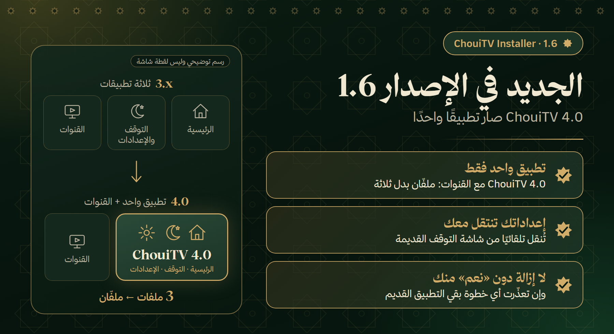
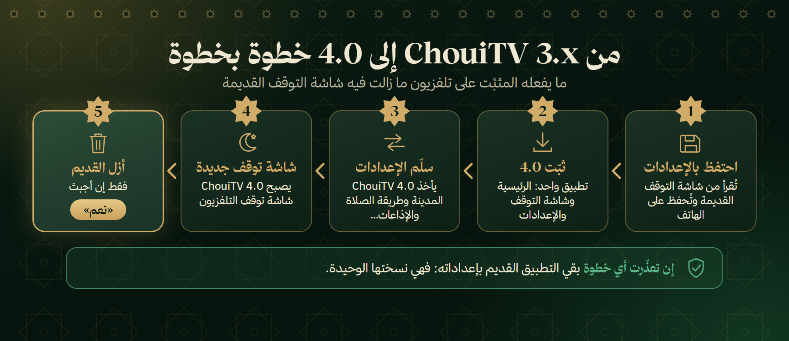

<p align="center"></p>

<p align="center"><a href="https://github.com/EMCHOUIT/ChouiTV-Installer/releases/latest/download/ChouiTV-Installer.apk"></a></p>

<p align="center"><b>🇲🇦 العربية</b> &nbsp;·&nbsp; <a href="README.fr.md">🇫🇷 Français</a> &nbsp;·&nbsp; <a href="README.en.md">🇬🇧 English</a></p>

<p align="center">
<a href="https://github.com/EMCHOUIT/ChouiTV-Installer/releases/latest"></a>

<a href="LICENSE"></a>
<a href="https://github.com/EMCHOUIT/ChouiTV-Installer/stargazers"></a>
</p>

<p align="center"><a href="#new">🆕 الجديد</a> · <a href="#why">✨ لماذا</a> · <a href="#journey">🚀 الرحلة</a> · <a href="#installs">📦 ما يثبّته</a> · <a href="#safety">🛡️ الأمان</a> · <a href="#cleanup">🧹 التنظيف</a> · <a href="#settings">🔁 الإعدادات</a> · <a href="#migration">🔄 إلى 4.0</a> · <a href="#faq">❓ أسئلة</a> · <a href="#build">🛠️ البناء</a> · <a href="#versions">📜 الإصدارات</a> · <a href="#download">⬇️ التحميل</a></p>

<div dir="rtl" align="right">

تطبيق صغير على هاتفك يجد تلفزيونك، فينظّفه إن شئت، وينزّل **أحدث إصدار** من [ChouiTV](https://github.com/EMCHOUIT/ChouiTV) ويثبّته ويضبطه، ثم ينقل إعداداتك إلى تلفزيون آخر. **يرشدك خطوة بخطوة، أو تختار بنفسك. بلا كمبيوتر ولا أوامر.**

<p align="center"><a href="https://github.com/EMCHOUIT/ChouiTV-Installer/releases/latest/download/ChouiTV-Installer.apk"></a><br><sub>لهاتف أندرويد 8 أو أحدث · الملف نحو 1 ميغابايت</sub></p>

<a id="new"></a>

## 🆕 الجديد في الإصدار 1.6

</div>



<div dir="rtl" align="right">

- **ChouiTV 4.0 تطبيق واحد**: الواجهة الرئيسية وشاشة التوقف والإعدادات معًا. يثبّت المثبِّت إذن **تطبيقًا واحدًا + القنوات** (ملفّان بدل ثلاثة).
- **إن كانت شاشة التوقف القديمة على تلفزيونك** فتُحفظ إعداداتها ثم تُنقل إلى 4.0، ولا تُزال القديمة إلا بعد أن تقول «نعم» ([التفاصيل](#migration)).
- **ثقة أشدّ** (الإصداران 1.4 و1.5): فحص إلزامي لكل ملف، وملف الإصدار يوقّعه صاحب المشروع ([الأمان](#safety)).
- **الإذاعات** تُحفظ وتُرسل مع بقية الإعدادات: البلدان والمحطات غير المؤشَّرة والمفضلة.

<a id="why"></a>

## ✨ لماذا هذا التطبيق؟

<table dir="rtl">
<tr><td width="50%" valign="top">🧭<br><b>يرشدك أو تختار</b><br><sub>أسلوب «دعني أُرشَد» بمساعد خطوة بخطوة، أو «أختار بنفسي» لخمس مساحات مباشرة.</sub></td><td width="50%" valign="top">🧹<br><b>تنظيف تتحكّم فيه</b><br><sub>خانة لكل تطبيق، بأسماء مفهومة، ولا شيء دون موافقتك.</sub></td></tr>
<tr><td width="50%" valign="top">🔁<br><b>إعداداتك تتنقّل</b><br><sub>احفظ إعدادات تلفزيون باسم، وأرسلها إلى آخر الآن أو لاحقًا.</sub></td><td width="50%" valign="top">🛡️<br><b>كل شيء قابل للتراجع</b><br><sub>تُوقَف التطبيقات ولا تُحذف، وشبكة أمان على التلفزيون.</sub></td></tr>
</table>

<a id="journey"></a>

## 🚀 الرحلة في خمس شاشات

</div>


<div dir="rtl" align="right">

1. **اللغة**: العربية أو الفرنسية أو الإنجليزية.
2. **الأسلوب**: «دعني أُرشَد» (مساعد خطوة بخطوة، يمكنك الاستئناف إن خرجت) أو «أختار بنفسي».
3. **المسار أو المساحات**: «جهّز تلفزيوني»، «انسخ من تلفزيون إلى آخر»، «أرسل إعدادات محفوظة»، «أعِد تطبيقًا»، أو المساحات الخمس مباشرة.
4. **التنظيف**: ترى الخطة قبل أي تغيير، وتؤشّر على ما لا تستعمله.
5. **التثبيت والضبط**: شريط تقدّم ونسبة مئوية، ثم المدينة والمنطقة الزمنية وطريقة حساب الصلاة.

والتثبيت نفسه خطوتان فقط: **ChouiTV** ثم **القنوات**. وإن كانت على التلفزيون شاشة التوقف القديمة فتُضاف إليهما [خطوة نقل الإعدادات](#migration).

<a id="installs"></a>

## 📦 ماذا يثبّت؟

| التطبيق | دوره | الحجم |
|---|---|---|
| **ChouiTV 4.0** (`ma.chouitv.home`) | تطبيق واحد: الواجهة الرئيسية مع الصلاة والاستماع والأذكار، وشاشة التوقف (الأذكار والتسبيح الموجَّه وحكمة من التاريخ)، والإعدادات | نحو 3.5 ميغابايت |
| **تطبيق القنوات** | 311 قناة عربية مباشرة | |

كان ChouiTV 3.x يأتي بتطبيقين منفصلين (الواجهة وشاشة التوقف)، فكان المثبِّت يثبّت ثلاثة ملفات. ومنذ 4.0 صارا تطبيقًا واحدًا، فصار التثبيت **ملفّين**.

يقرأ التطبيق رقم الإصدار من [`latest.json`](https://raw.githubusercontent.com/EMCHOUIT/ChouiTV/main/latest.json)، فيثبّت دائمًا **آخر إصدار** دون أن يُعاد بناؤه، بعد الفحوص المذكورة في الفقرة التالية. وإن كان ملف الإصدار القديم يذكر تطبيقي ChouiTV (الواجهة وشاشة التوقف) فما زال مقبولًا، ويُتجاهل سطر شاشة التوقف.

<a id="safety"></a>

## 🛡️ الأمان

### ما يتحقق منه المثبِّت قبل أن يلمس تلفزيونك (الإصداران 1.4 و1.5)

1. **ملف الإصدار موقَّع** (1.5): لا يصدّق المثبِّت `latest.json` إلا إن طابق توقيعه `latest.json.sig` المفتاحَ العام لصاحب المشروع المدمج فيه. فمن يخترق حساب GitHub لا يستطيع أن يوجّه المثبِّت إلى ملف آخر، لأن التوقيع يُصنع على حاسوب المالك لا على GitHub. ويُرفض كل ملف إصدار أقدم من الحد الأدنى (رقم النسخة 180)، فلا يُعاد تلفزيونك إلى نسخة معروفة العيب.
2. **عناوين ChouiTV فقط**: لا تُحمَّل الملفات إلا من صفحة إصدارات ChouiTV على GitHub عبر https، وعنوان يحوي ما قد يحوّله إلى مكان آخر يُرفض.
3. **بصمة SHA-256 إلزامية** لكل ملف: لا ملف دون بصمة، ولا ملف يخالفها.
4. **تطبيق ChouiTV يُفحص على الهاتف قبل إرساله**: أهو التطبيق المطلوب، وبالإصدار المعلَن، وموقَّع بمفتاح ChouiTV؟ وإلا حُذف الملف ولم يُرسَل منه شيء.
5. **الإصدار يُفحص على التلفزيون بعد التثبيت**، ويُعاد كل تطبيق **مرة واحدة** إن فشل.
6. **لا إزالة بلا سؤال**: إن كان على التلفزيون تطبيق بالاسم نفسه لكنه موقَّع بمفتاح آخر، يسألك المثبِّت قبل إزالته، وتُحفظ إعداداته وتعود بعد التثبيت قدر الإمكان.

**ما لا يفحصه المثبِّت، ونقوله بصراحة:**

- **تطبيق القنوات** هو نسخة طرف آخر محفوظة كما هي: يُفحص بصمته فقط (SHA-256 من ملف الإصدار أو بصمة مثبّتة في المثبِّت)، لا مفتاح توقيعه ولا رقم إصداره.
- **ما بداخل تطبيقات ChouiTV** لا يراجعه المثبِّت: هو يتأكد أنها من صاحب المشروع وكما نُشرت، لا أنها خالية من العيوب.
- **لا يحميك من مفتاح مسروق**: من يملك مفتاح توقيع المالك أو حاسوبه يستطيع أن يوقّع ملف إصدار.
- **ملف المثبِّت نفسه** تتحقق منه أنت: انظر [تحقّق من الملف](#download).

### على التلفزيون نفسه

- **شبكة أمان**: قبل تعطيل واجهة التلفزيون الأصلية يضع التطبيق عليه سكربتًا يعيدها وحده بعد 5 دقائق إن لم يفتح ChouiTV.
- **احترام تلفزيونك**: إن رفض تعطيل واجهته (مثل Nokia Streaming Box 8000) تبقى كما هي ويُخبَر المستخدم.
- **تنظيف بلا مخاطرة**: التنظيف اختياري، يوقف التطبيقات ولا يحذفها، ويفحص التلفزيون بعد كل مجموعة ويعيدها وحده إن ساء الحال، وتعيد أي تطبيق من مساحة «أعِد تفعيل تطبيقات».
- **خصوصية**: بلا حسابات ولا إعلانات ولا تتبّع، والمفتاح الذي يعرّف هاتفك يبقى فيه.

</div>

> [!TIP]
> **عند الانتهاء**: أغلق «تصحيح الشبكة» على التلفزيون.

<div dir="rtl" align="right">


<a id="cleanup"></a>

## 🧹 نظّف تلفزيونك بأمان

</div>


<div dir="rtl" align="right">

تأتي بعض التلفزيونات (Xiaomi وTCL وغيرها) بتطبيقات مثبّتة مسبقًا لا تحتاجها: تتبّع وإحصاءات وإعلانات وخدمات تبطئ الجهاز. وقد تكون لديك تطبيقات تبدأ مع التلفزيون ولا تستعملها. **التنظيف اختياري، وأنت من يقرّر.**

- **خانة لكل تطبيق**: «مثبّتة مسبقًا» (مؤشَّرة مسبقًا)، و«البث والترفيه» (Netflix وPrime Video وغيرها، غير مؤشَّرة)، و«تطبيقاتك المثبّتة» مع توصية على ما يبدأ مع التلفزيون ويبطئه.
- **أسماء مفهومة**: اسم التطبيق وتحته اسم الحزمة.
- **تأكيد قبل البدء**: تراجع القائمة وتترك بلا علامة ما تستعمله، فيبقى كما هو.
- **يوقف ولا يحذف**: ويفحص التلفزيون بعد كل مجموعة، ويعيدها وحده إن ساء الحال، وإن انقطع الاتصال أعاد التلفزيون كل شيء خلال 5 دقائق.
- **محمي دائمًا**: ChouiTV وخدمات Google والإعدادات وأي واجهة رئيسية.
- **أعِد أي تطبيق متى شئت**: من مساحة «أعِد تفعيل تطبيقات»، وهي تقرأ ما هو موقوف على التلفزيون نفسه.

</div>

<a id="settings"></a>

## 🔁 انسخ إعداداتك إلى تلفزيون آخر


<div dir="rtl" align="right">

استعمل مساحتَي **استرجاع إعدادات** و**إرسال إعدادات** (أو مسار «انسخ من تلفزيون إلى آخر» بمساعد).

- **احفظ باسم تختاره**: تحفظ إعدادات التلفزيون المتصل (المدينة، الصلاة، الأذان، اللوحات، الفرق، اختصارات الرئيسية، والإذاعات: البلدان والمحطات غير المؤشَّرة والمفضلة…) على هاتفك فقط.
- **أرسل الآن أو لاحقًا**: إن كان التلفزيونان معًا فأرسل فورًا، وإلا خذ الإعدادات معك وأرسلها من «أرسل إعدادات محفوظة».
- **معاينة وتراجع**: ترى التغييرات قبل التطبيق، ويحتفظ الإرسال بنسخة من الإعدادات السابقة.
- **لا يُحفظ أبدًا**: عنوان IP أو اسم الواي فاي، الرقم التسلسلي، صورك ومهامك.

يلزم ChouiTV 3.173 أو أحدث على التلفزيونين.

<a id="migration"></a>

## 🔄 الانتقال من ChouiTV 3.x إلى 4.0

</div>



<div dir="rtl" align="right">

إن كان على تلفزيونك تطبيق شاشة التوقف القديم (`ma.chouitv.screensaver`) فلا حاجة إلى فعل شيء بنفسك. يفعل المثبِّت ما يلي بالترتيب:

1. **يحتفظ بالإعدادات**: يقرأ إعدادات الشاشة القديمة (المدينة وطريقة الصلاة والإذاعات…) ويحفظها في مساحة التطبيق الخاصة على هاتفك.
2. **يثبّت ChouiTV 4.0.**
3. **يسلّم الإعدادات** إلى 4.0.
4. **يختار شاشة التوقف الجديدة**: يجعل شاشة توقف 4.0 هي شاشة التلفزيون.
5. **يسألك** إن كنت تريد إزالة التطبيق القديم (إبقاؤه أو إزالته). لا يُزال شيء دون «نعم» منك.

**ما يبقى بأمان**: إن تعذّر حفظ الإعدادات، أو رفض 4.0 استلامها، أو لم تُجب بـ«نعم»، يبقى التطبيق القديم في مكانه بإعداداته، لأنه يحمل النسخة الوحيدة منها. وتُمسح النسخة المؤقتة من الهاتف عند انتهاء النقل. وإن لم يكن القديم على التلفزيون فلا يُنقل شيء.

وتظهر نتيجة النقل في شاشة النهاية: «نُقلت الإعدادات وأُزيل التطبيق القديم»، أو «…وبقي التطبيق القديم»، أو «تعذّر نقل الإعدادات، ويبقى التطبيق القديم».

<a id="faq"></a>

## ❓ أسئلة

<details><summary><b>لا أجد تلفزيوني في القائمة</b></summary>

تأكد أن الهاتف والتلفزيون على **نفس الواي فاي** وأن «تصحيح الشبكة» مفعّل على التلفزيون. يمكنك أيضًا كتابة عنوان التلفزيون يدويًا.
</details>

<details><summary><b>لا تظهر نافذة «السماح» على التلفزيون</b></summary>

ينتظر التطبيق دقيقتين. إن لم تظهر النافذة، أعد تشغيل التلفزيون ثم حاول مرة أخرى: قد يكون طلب سابق عالقًا.
</details>

<details><summary><b>الزر Home لا يفتح ChouiTV</b></summary>

بعض التلفزيونات تفرض واجهتها. يخبرك التطبيق بذلك في النهاية، وتجد ChouiTV في قائمة التطبيقات. وفي كل حال يعيد التلفزيون واجهته الأصلية وحده إن لم تعمل الجديدة.
</details>

<details><summary><b>كيف أتراجع؟</b></summary>

أعد تفعيل واجهة التلفزيون من إعداداته، أو استعمل `optimize/reset.sh` من [ChouiTV](https://github.com/EMCHOUIT/ChouiTV).
</details>

<details><summary><b>هل التنظيف آمن؟</b></summary>

هو اختياري ويوقف ولا يحذف، ويعرض عليك الخطة أولًا ويفحص التلفزيون بعد كل مجموعة. لكن التطبيقات الموقوفة لا تتحدّث، وقد يعيد تحديث النظام تفعيل بعضها. وبعض التلفزيونات تفقد الواي فاي المحفوظ إن أُوقفت خدمة الإعداد، لذلك تُحمى هي أيضًا.
</details>

<details><summary><b>كيف أتراجع عن التنظيف؟</b></summary>

افتح مساحة «أعِد تفعيل تطبيقات» وأشّر على ما تريد إرجاعه: تقرأ ما هو موقوف على التلفزيون نفسه، فيصلح أي هاتف. وعلى التلفزيون نسخة نصية في `/data/local/tmp/chouitv-restore.txt`.
</details>

<details><summary><b>ما الفرق بين «دعني أُرشَد» و«أختار بنفسي»؟</b></summary>

الأول مساعد يخبرك بما تفعل خطوة بخطوة ويتيح الاستئناف إن خرجت. الثاني يفتح مباشرةً المساحات الخمس. ويمكنك تغيير الأسلوب في أي وقت.
</details>

<details><summary><b>كيف أنقل إعداداتي إلى تلفزيون آخر؟</b></summary>

من «انسخ من تلفزيون إلى آخر»: تحفظ إعدادات التلفزيون الأول باسم، ثم ترسلها الآن إن كان التلفزيونان معًا، أو لاحقًا من «أرسل إعدادات محفوظة». يلزم ChouiTV 3.173 أو أحدث على التلفزيونين، وتُعرض المعاينة قبل التطبيق ويمكن التراجع.
</details>

<details><summary><b>أرى في قائمة شاشات التوقف في أندرويد اسمين متطابقين</b></summary>

يحدث ذلك إن انتقلتَ إلى 4.0 يدويًا (بتثبيته فوق القديم دون المثبِّت) ما دامت شاشة التوقف القديمة ما زالت على التلفزيون: كلا التطبيقين يقدّم شاشة توقف باسم ChouiTV. اختر الجديد (4.0)، ثم أزل القديم من إعدادات التلفزيون ← التطبيقات. وإن استعملت المثبِّت فهو يختار الجديد بنفسه ويسألك عن إزالة القديم.
</details>

<details><summary><b>التلفزيون لا يُستجيب أثناء الانتقال إلى 4.0</b></summary>

إن انقطع الاتصال قبل أن يُحفظ شيء فلم يتغيّر شيء على التلفزيون. وإن انقطع بعد تثبيت 4.0 فالقديم لم يُزَل (لا يُزال إلا بعد «نعم» منك)، فأعد تشغيل التلفزيون وافتح المثبِّت وكرّر العملية: ما دام القديم موجودًا يعيد المثبِّت محاولة النقل. تأكد أن الهاتف والتلفزيون على الواي فاي نفسه وأن «تصحيح الشبكة» مفعّل.
</details>

<details><summary><b>فشل نقل الإعدادات، فماذا حدث للتطبيق القديم؟</b></summary>

يبقى في مكانه بإعداداته، ولا يُعرض عليك حذفه أصلًا: فهو يحمل النسخة الوحيدة منها. تُظهر شاشة النهاية «تعذّر نقل الإعدادات، ويبقى التطبيق القديم». يمكنك إعادة المحاولة من «جهّز تلفزيوني»، أو ضبط الإعدادات يدويًا في 4.0، أو إرسال إعدادات محفوظة من «أرسل إعدادات محفوظة».
</details>

<details><summary><b>هل ثلاثة ملفات أم ملفّان؟ ولماذا لا أجد تطبيق شاشة التوقف؟</b></summary>

منذ 4.0 صارت الواجهة الرئيسية وشاشة التوقف والإعدادات تطبيقًا واحدًا (`ma.chouitv.home`)، ويثبّت المثبِّت إلى جانبه تطبيق القنوات فقط. شاشة التوقف موجودة داخل التطبيق نفسه، فاختَرها من إعدادات التلفزيون ← شاشة التوقف إن لم يخترها المثبِّت.
</details>

<a id="build"></a>

## 🛠️ البناء

JDK 17 وAndroid SDK (المنصة 34):

```bash
git clone https://github.com/EMCHOUIT/ChouiTV-Installer
cd ChouiTV-Installer
./gradlew :app:assembleRelease      # الملف في app/build/outputs/apk/release
./gradlew :app:testDebugUnitTest    # 108 اختبارات على JVM
```

الإصدار الحالي: **1.6** (`versionCode 9`)، ويعمل على أندرويد 8 فأحدث (`minSdk 26`).

الصور المرسومة في `docs/media` (بطاقة «الجديد» ومخطط الانتقال ورقم الإصدار في الغلاف ورمز QR) تُعاد بالأمر `python docs/media/build_media.py` (يلزم Pillow وEdge أو Chrome)؛ أما لقطات الهاتف فحقيقية ولا تُولَّد.

<a id="versions"></a>

## 📜 الإصدارات

| الإصدار | ما تغيّر |
|---|---|
| **1.6** | ChouiTV 4.0 تطبيق واحد: يثبّت المثبِّت تطبيقًا واحدًا + القنوات؛ نقل إعدادات شاشة التوقف القديمة، ولا إزالة إلا بعد «نعم»؛ الإذاعات ضمن الإعدادات المحفوظة |
| **1.5** | ملف الإصدار يجب أن يوقّعه صاحب المشروع (`latest.json.sig`) |
| **1.4** | الثقة: بصمة إلزامية، وعناوين ChouiTV فقط، وفحص كل تطبيق على الهاتف (التطبيق والإصدار والمفتاح) ثم على التلفزيون، ومحاولة ثانية واحدة، وسؤال قبل إزالة تطبيق بمفتاح آخر |
| **1.3** | زر تحديث، وعرض الماركة والطراز في قائمة التلفزيونات، وشاشة نهاية واحدة لكل عملية |
| **1.2** | أسلوبان (مُرشَد أو حر)، وخمس مساحات، وتنظيف بخانة لكل تطبيق، ونقل الإعدادات بين التلفزيونات |

<a id="download"></a>

<h2 align="center">⬇️ التحميل المباشر</h2>

<p align="center"><br><sub>امسح الرمز من شاشة حاسوبك لفتح الرابط على هاتفك.</sub></p>

<p align="center"><a href="https://github.com/EMCHOUIT/ChouiTV-Installer/releases/latest/download/ChouiTV-Installer.apk"></a><br><sub><code>ChouiTV-Installer.apk</code> · نحو 1 ميغابايت</sub></p>

<p align="center"><a href="https://github.com/EMCHOUIT/ChouiTV-Installer/releases/latest"></a> <a href="https://github.com/EMCHOUIT/ChouiTV-Installer/releases"></a></p>

<p align="center">📱 أندرويد 8 أو أحدث &nbsp;·&nbsp; 🔒 موقَّع، بلا حساب ولا إعلانات &nbsp;·&nbsp; 📦 <a href="https://github.com/EMCHOUIT/ChouiTV-Installer/releases">كل الإصدارات</a></p>

<h3 align="center">التثبيت في ثلاث خطوات</h3>

<table align="center" dir="rtl">
<tr><td width="33%" valign="top" align="center">1️⃣<br><br><b>نزّل</b> الملف <code>ChouiTV-Installer.apk</code> على هاتفك (الزر أعلاه، أو امسح الرمز من شاشة أخرى).</td><td width="33%" valign="top" align="center">2️⃣<br><br><b>افتحه.</b> إن طلب أندرويد إذنًا فاسمح مرة واحدة للمتصفح أو لمدير الملفات بتثبيت التطبيقات. وقد يظهر تحذير «تطبيق غير معروف»: الشيفرة مفتوحة وتستطيع بناءها بنفسك (<a href="#build">البناء</a>).</td><td width="33%" valign="top" align="center">3️⃣<br><br><b>افتح ChouiTV Installer</b> واتبع الخطوات.</td></tr>
</table>

<div align="center">

<details><summary><b>🔍 تحقّق من الملف</b></summary>

الرابط المباشر ينزّل دائمًا **آخر إصدار**. وفي [صفحة الإصدار](https://github.com/EMCHOUIT/ChouiTV-Installer/releases/latest) الملف نفسه باسم يحمل رقم الإصدار (مثل `ChouiTV-Installer-1.6.apk`). تعرض الصفحة بصمة SHA-256 بجانب الملف. قارنها بنتيجة الأمر:

```bash
sha256sum ChouiTV-Installer.apk                       # Linux, macOS
certutil -hashfile ChouiTV-Installer.apk SHA256       # Windows
```

وبصمة شهادة التوقيع (SHA-256) واحدة في كل الإصدارات:

```text
f29f993b7456170455dcc574a2bc5f1f74b97f7995a564f8a839175d068a79c1
```

للتحقق منها:

```bash
apksigner verify --print-certs ChouiTV-Installer.apk
```
</details>

</div>

## 💚 الشكر والترخيص

ترخيص **MIT** (EMChouit). الخطوط وتراخيصها في [THIRD_PARTY_NOTICES.md](THIRD_PARTY_NOTICES.md). التطبيقات المثبَّتة هي [ChouiTV](https://github.com/EMCHOUIT/ChouiTV). **أعجبك المشروع؟ ضع له نجمة ⭐ فهي تشجّعنا على الاستمرار.**

</div>
