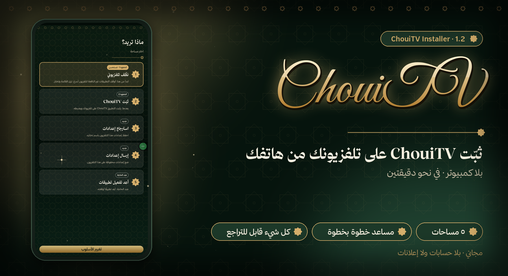
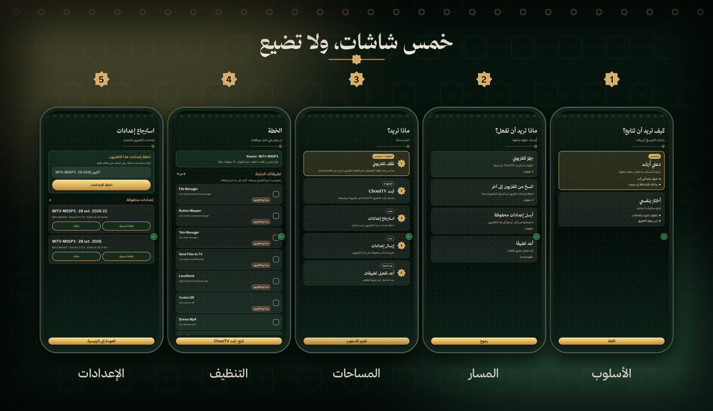
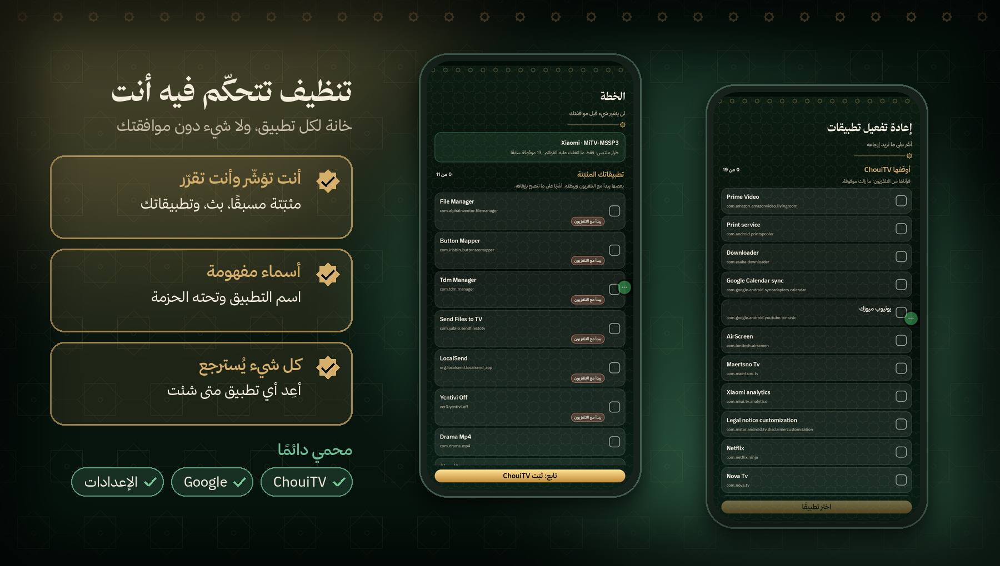
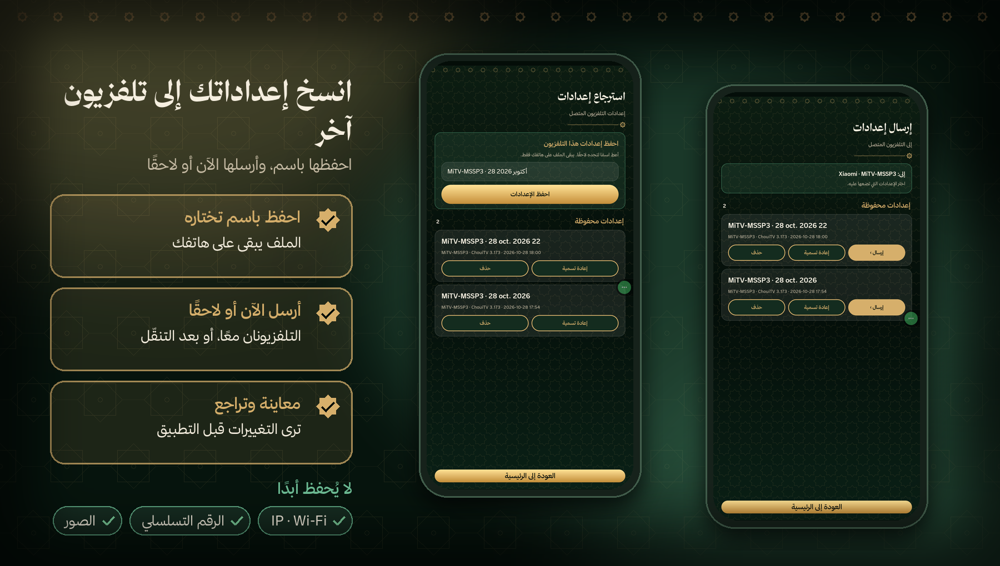

<p align="center"></p>

<p align="center"><a href="https://github.com/EMCHOUIT/ChouiTV-Installer/releases/latest/download/ChouiTV-Installer.apk"></a></p>

<p align="center"><b>🇲🇦 العربية</b> &nbsp;·&nbsp; <a href="README.fr.md">🇫🇷 Français</a> &nbsp;·&nbsp; <a href="README.en.md">🇬🇧 English</a></p>

<p align="center">
<a href="https://github.com/EMCHOUIT/ChouiTV-Installer/releases/latest"></a>

<a href="LICENSE"></a>
<a href="https://github.com/EMCHOUIT/ChouiTV-Installer/stargazers"></a>
</p>

<p align="center"><a href="#why">✨ لماذا</a> · <a href="#journey">🚀 الرحلة</a> · <a href="#installs">📦 ما يثبّته</a> · <a href="#safety">🛡️ الأمان</a> · <a href="#cleanup">🧹 التنظيف</a> · <a href="#settings">🔁 الإعدادات</a> · <a href="#faq">❓ أسئلة</a> · <a href="#build">🛠️ البناء</a> · <a href="#download">⬇️ التحميل</a></p>

<div dir="rtl" align="right">

تطبيق صغير على هاتفك يجد تلفزيونك، فينظّفه إن شئت، وينزّل **أحدث إصدار** من [ChouiTV](https://github.com/EMCHOUIT/ChouiTV) ويثبّته ويضبطه، ثم ينقل إعداداتك إلى تلفزيون آخر. **يرشدك خطوة بخطوة، أو تختار بنفسك. بلا كمبيوتر ولا أوامر.**

<p align="center"><a href="https://github.com/EMCHOUIT/ChouiTV-Installer/releases/latest/download/ChouiTV-Installer.apk"></a><br><sub>لهاتف أندرويد 8 أو أحدث · الملف نحو 1 ميغابايت</sub></p>

<a id="why"></a>

## ✨ لماذا هذا التطبيق؟

<table dir="rtl">
<tr><td width="50%" valign="top">🧭<br><b>يرشدك أو تختار</b><br><sub>أسلوب «دعني أُرشَد» بمساعد خطوة بخطوة، أو «أختار بنفسي» لخمس مساحات مباشرة.</sub></td><td width="50%" valign="top">🧹<br><b>تنظيف تتحكّم فيه</b><br><sub>خانة لكل تطبيق، بأسماء مفهومة، ولا شيء دون موافقتك.</sub></td></tr>
<tr><td width="50%" valign="top">🔁<br><b>إعداداتك تتنقّل</b><br><sub>احفظ إعدادات تلفزيون باسم، وأرسلها إلى آخر الآن أو لاحقًا.</sub></td><td width="50%" valign="top">🛡️<br><b>كل شيء قابل للتراجع</b><br><sub>تُوقَف التطبيقات ولا تُحذف، وشبكة أمان على التلفزيون.</sub></td></tr>
</table>

<a id="journey"></a>

## 🚀 الرحلة في خمس شاشات

</div>



<div dir="rtl" align="right">

1. **اللغة**: العربية أو الفرنسية أو الإنجليزية.
2. **الأسلوب**: «دعني أُرشَد» (مساعد خطوة بخطوة، يمكنك الاستئناف إن خرجت) أو «أختار بنفسي».
3. **المسار أو المساحات**: «جهّز تلفزيوني»، «انسخ من تلفزيون إلى آخر»، «أرسل إعدادات محفوظة»، «أعِد تطبيقًا»، أو المساحات الخمس مباشرة.
4. **التنظيف**: ترى الخطة قبل أي تغيير، وتؤشّر على ما لا تستعمله.
5. **التثبيت والضبط**: شريط تقدّم ونسبة مئوية، ثم المدينة والمنطقة الزمنية وطريقة حساب الصلاة.

<a id="installs"></a>

## 📦 ماذا يثبّت؟

| التطبيق | دوره |
|---|---|
| **الواجهة الرئيسية** | شاشة التلفزيون الأولى، مع الصلاة والاستماع والأذكار |
| **شاشة التوقف والإعدادات** | الأذكار والتسبيح الموجَّه وحكمة من التاريخ |
| **تطبيق القنوات** | 311 قناة عربية مباشرة |

يقرأ التطبيق رقم الإصدار من [`latest.json`](https://raw.githubusercontent.com/EMCHOUIT/ChouiTV/main/latest.json)، فيثبّت دائمًا **آخر إصدار** دون أن يُعاد بناؤه، ويتحقق من بصمة SHA-256 لكل ملف قبل إرساله.

<a id="safety"></a>

## 🛡️ الأمان

- **شبكة أمان**: قبل تعطيل واجهة التلفزيون الأصلية يضع التطبيق عليه سكربتًا يعيدها وحده بعد 5 دقائق إن لم يفتح ChouiTV.
- **احترام تلفزيونك**: إن رفض تعطيل واجهته (مثل Nokia Streaming Box 8000) تبقى كما هي ويُخبَر المستخدم.
- **تنظيف بلا مخاطرة**: التنظيف اختياري، يوقف التطبيقات ولا يحذفها، ويفحص التلفزيون بعد كل مجموعة ويعيدها وحده إن ساء الحال، وتعيد أي تطبيق من مساحة «أعِد تفعيل تطبيقات».
- **خصوصية**: بلا حسابات ولا إعلانات ولا تتبّع، والمفتاح الذي يعرّف هاتفك يبقى فيه.

</div>

> [!TIP]
> **عند الانتهاء**: أغلق «تصحيح الشبكة» على التلفزيون.

<div dir="rtl" align="right">


<a id="cleanup"></a>

## 🧹 نظّف تلفزيونك بأمان

</div>



<div dir="rtl" align="right">

تأتي بعض التلفزيونات (Xiaomi وTCL وغيرها) بتطبيقات مثبّتة مسبقًا لا تحتاجها: تتبّع وإحصاءات وإعلانات وخدمات تبطئ الجهاز. وقد تكون لديك تطبيقات تبدأ مع التلفزيون ولا تستعملها. **التنظيف اختياري، وأنت من يقرّر.**

- **خانة لكل تطبيق**: «مثبّتة مسبقًا» (مؤشَّرة مسبقًا)، و«البث والترفيه» (Netflix وPrime Video وغيرها، غير مؤشَّرة)، و«تطبيقاتك المثبّتة» مع توصية على ما يبدأ مع التلفزيون ويبطئه.
- **أسماء مفهومة**: اسم التطبيق وتحته اسم الحزمة.
- **تأكيد قبل البدء**: تراجع القائمة وتترك بلا علامة ما تستعمله، فيبقى كما هو.
- **يوقف ولا يحذف**: ويفحص التلفزيون بعد كل مجموعة، ويعيدها وحده إن ساء الحال، وإن انقطع الاتصال أعاد التلفزيون كل شيء خلال 5 دقائق.
- **محمي دائمًا**: ChouiTV وخدمات Google والإعدادات وأي واجهة رئيسية.
- **أعِد أي تطبيق متى شئت**: من مساحة «أعِد تفعيل تطبيقات»، وهي تقرأ ما هو موقوف على التلفزيون نفسه.

</div>

<a id="settings"></a>

## 🔁 انسخ إعداداتك إلى تلفزيون آخر



<div dir="rtl" align="right">

استعمل مساحتَي **استرجاع إعدادات** و**إرسال إعدادات** (أو مسار «انسخ من تلفزيون إلى آخر» بمساعد).

- **احفظ باسم تختاره**: تحفظ إعدادات التلفزيون المتصل (المدينة، الصلاة، الأذان، اللوحات، الفرق، اختصارات الرئيسية…) على هاتفك فقط.
- **أرسل الآن أو لاحقًا**: إن كان التلفزيونان معًا فأرسل فورًا، وإلا خذ الإعدادات معك وأرسلها من «أرسل إعدادات محفوظة».
- **معاينة وتراجع**: ترى التغييرات قبل التطبيق، ويحتفظ الإرسال بنسخة من الإعدادات السابقة.
- **لا يُحفظ أبدًا**: عنوان IP أو اسم الواي فاي، الرقم التسلسلي، صورك ومهامك.

يلزم ChouiTV 3.173 أو أحدث على التلفزيونين.

<a id="faq"></a>

## ❓ أسئلة

<details><summary><b>لا أجد تلفزيوني في القائمة</b></summary>

تأكد أن الهاتف والتلفزيون على **نفس الواي فاي** وأن «تصحيح الشبكة» مفعّل على التلفزيون. يمكنك أيضًا كتابة عنوان التلفزيون يدويًا.
</details>

<details><summary><b>لا تظهر نافذة «السماح» على التلفزيون</b></summary>

ينتظر التطبيق دقيقتين. إن لم تظهر النافذة، أعد تشغيل التلفزيون ثم حاول مرة أخرى: قد يكون طلب سابق عالقًا.
</details>

<details><summary><b>الزر Home لا يفتح ChouiTV</b></summary>

بعض التلفزيونات تفرض واجهتها. يخبرك التطبيق بذلك في النهاية، وتجد ChouiTV في قائمة التطبيقات. وفي كل حال يعيد التلفزيون واجهته الأصلية وحده إن لم تعمل الجديدة.
</details>

<details><summary><b>كيف أتراجع؟</b></summary>

أعد تفعيل واجهة التلفزيون من إعداداته، أو استعمل `optimize/reset.sh` من [ChouiTV](https://github.com/EMCHOUIT/ChouiTV).
</details>

<details><summary><b>هل التنظيف آمن؟</b></summary>

هو اختياري ويوقف ولا يحذف، ويعرض عليك الخطة أولًا ويفحص التلفزيون بعد كل مجموعة. لكن التطبيقات الموقوفة لا تتحدّث، وقد يعيد تحديث النظام تفعيل بعضها. وبعض التلفزيونات تفقد الواي فاي المحفوظ إن أُوقفت خدمة الإعداد، لذلك تُحمى هي أيضًا.
</details>

<details><summary><b>كيف أتراجع عن التنظيف؟</b></summary>

افتح مساحة «أعِد تفعيل تطبيقات» وأشّر على ما تريد إرجاعه: تقرأ ما هو موقوف على التلفزيون نفسه، فيصلح أي هاتف. وعلى التلفزيون نسخة نصية في `/data/local/tmp/chouitv-restore.txt`.
</details>

<details><summary><b>ما الفرق بين «دعني أُرشَد» و«أختار بنفسي»؟</b></summary>

الأول مساعد يخبرك بما تفعل خطوة بخطوة ويتيح الاستئناف إن خرجت. الثاني يفتح مباشرةً المساحات الخمس. ويمكنك تغيير الأسلوب في أي وقت.
</details>

<details><summary><b>كيف أنقل إعداداتي إلى تلفزيون آخر؟</b></summary>

من «انسخ من تلفزيون إلى آخر»: تحفظ إعدادات التلفزيون الأول باسم، ثم ترسلها الآن إن كان التلفزيونان معًا، أو لاحقًا من «أرسل إعدادات محفوظة». يلزم ChouiTV 3.173 أو أحدث على التلفزيونين، وتُعرض المعاينة قبل التطبيق ويمكن التراجع.
</details>

<a id="build"></a>

## 🛠️ البناء

JDK 17 وAndroid SDK (المنصة 34):

```bash
git clone https://github.com/EMCHOUIT/ChouiTV-Installer
cd ChouiTV-Installer
./gradlew :app:assembleRelease
```

<a id="download"></a>

<h2 align="center">⬇️ التحميل المباشر</h2>

<p align="center"><br><sub>امسح الرمز من شاشة حاسوبك لفتح الرابط على هاتفك.</sub></p>

<p align="center"><a href="https://github.com/EMCHOUIT/ChouiTV-Installer/releases/latest/download/ChouiTV-Installer.apk"></a><br><sub><code>ChouiTV-Installer.apk</code> · نحو 1 ميغابايت</sub></p>

<p align="center"><a href="https://github.com/EMCHOUIT/ChouiTV-Installer/releases/latest"></a> <a href="https://github.com/EMCHOUIT/ChouiTV-Installer/releases"></a></p>

<p align="center">📱 أندرويد 8 أو أحدث &nbsp;·&nbsp; 🔒 موقَّع، بلا حساب ولا إعلانات &nbsp;·&nbsp; 📦 <a href="https://github.com/EMCHOUIT/ChouiTV-Installer/releases">كل الإصدارات</a></p>

<h3 align="center">التثبيت في ثلاث خطوات</h3>

<table align="center" dir="rtl">
<tr><td width="33%" valign="top" align="center">1️⃣<br><br><b>نزّل</b> الملف <code>ChouiTV-Installer.apk</code> على هاتفك (الزر أعلاه، أو امسح الرمز من شاشة أخرى).</td><td width="33%" valign="top" align="center">2️⃣<br><br><b>افتحه.</b> إن طلب أندرويد إذنًا فاسمح مرة واحدة للمتصفح أو لمدير الملفات بتثبيت التطبيقات. وقد يظهر تحذير «تطبيق غير معروف»: الشيفرة مفتوحة وتستطيع بناءها بنفسك (<a href="#build">البناء</a>).</td><td width="33%" valign="top" align="center">3️⃣<br><br><b>افتح ChouiTV Installer</b> واتبع الخطوات.</td></tr>
</table>

<div align="center">

<details><summary><b>🔍 تحقّق من الملف</b></summary>

تعرض [صفحة الإصدار](https://github.com/EMCHOUIT/ChouiTV-Installer/releases/latest) بصمة SHA-256 بجانب الملف. قارنها بنتيجة الأمر:

```bash
sha256sum ChouiTV-Installer.apk                       # Linux, macOS
certutil -hashfile ChouiTV-Installer.apk SHA256       # Windows
```

وبصمة شهادة التوقيع (SHA-256) واحدة في كل الإصدارات:

```text
f29f993b7456170455dcc574a2bc5f1f74b97f7995a564f8a839175d068a79c1
```

للتحقق منها:

```bash
apksigner verify --print-certs ChouiTV-Installer.apk
```
</details>

</div>

## 💚 الشكر والترخيص

ترخيص **MIT** (EMChouit). الخطوط وتراخيصها في [THIRD_PARTY_NOTICES.md](THIRD_PARTY_NOTICES.md). التطبيقات المثبَّتة هي [ChouiTV](https://github.com/EMCHOUIT/ChouiTV). **أعجبك المشروع؟ ضع له نجمة ⭐ فهي تشجّعنا على الاستمرار.**

</div>
